# bossi3dj

Live visuals for music. A 3D scene reacts to the sound, and you mix its picture on a projector or screen.

How it works, in four steps:

1. Music goes into **Magic Music Visuals** (Magic), a VJ program.
2. Magic turns it into about 38 simple numbers, for example *louder*, *bass*, *beat*, *night*, *fog*, *which camera*. Every number is a row in [osc/contract.json](osc/contract.json) and goes out as an OSC message named `/vj/<name>` (OSC is a small network message format).
3. One 3D scene reads the numbers and moves, glows and changes. Two scenes exist: a **Blender** scene and a **Godot** scene. Only one runs at a time, so both listen on the same port, udp 9201.
4. The scene publishes its picture as a **Syphon** video stream (a way for Mac apps to share frames). Magic picks it up, adds effects and mixes the two scenes.

The scenes hold no music logic. Magic decides what the music means, the scenes only take the numbers.

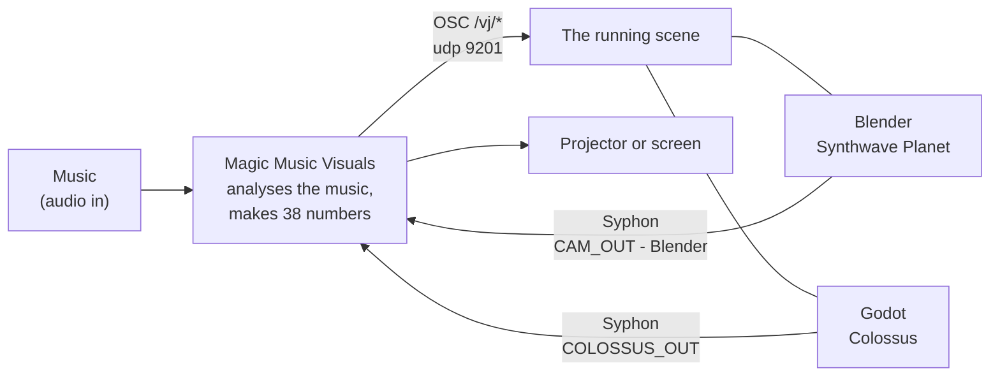

| Scene | Engine | Folder | What you see |
|---|---|---|---|
| Synthwave Planet | Blender 5.3 (EEVEE), built by script | [blender/](blender/) | a retro planet with pink and lilac hills, pyramids, water, flamingos, stars and a moon |
| Colossus | Godot 4.7 (Forward+, Metal) | [godot/colossus/](godot/colossus/) | an overcast dusk plain, a giant, and a small figure that climbs it |

## The Blender scene: Synthwave Planet

A whole small planet with a sun, a moon and a star sky. Fixed cameras (`CAM_0` to `CAM_10`) show it from the ground, from a river, from a coast and from orbit. `CAM_11` is the Flight shot, a camera that flies over the planet. The music changes the light and the weather:

- `/vj/night` moves the time of day: 0 is day, 0.25 sunset, 0.5 twilight, 1 night.
- `/vj/fog` sets how dense the fog bank is. Fog has its own colour, glow, size and wind (`/vj/fog_*`).
- `/vj/cam` cuts to a camera, `/vj/blend` sets how smoothly the cut flies over, `/vj/energy` how hard the camera moves.
- `/vj/flight` runs the Flight shot from orbit down to a skim over the mountains and a hover over the water.
- `/vj/grid` shows the real triangle edges of the ground at night as a glowing cyan net. By day there are none.
- `/vj/level`, `/vj/bass` and `/vj/beat` pulse the sun, the net, the pyramid edges and the water glints with the music. `/vj/hue` turns the whole palette.

The full list with ranges is in [osc/CONTROLS.md](osc/CONTROLS.md).

<table>
<tr>
<td width="50%">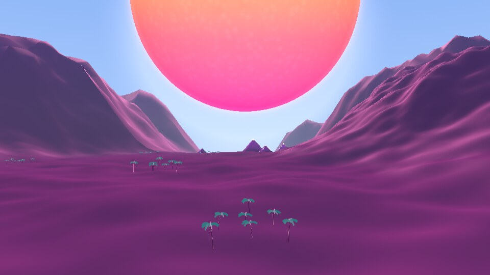<br><sub><b>Day, <code>CAM_0</code></b>: wide, up the plaza toward the pyramids and the sun (<code>/vj/night</code> 0).</sub></td>
<td width="50%">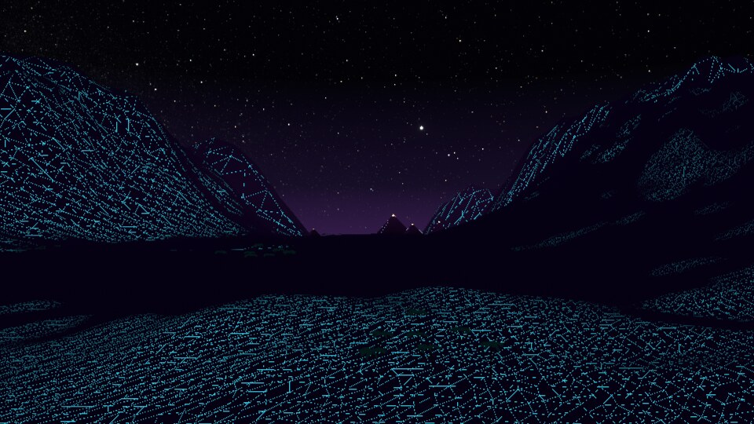<br><sub><b>Night with mesh edges, <code>CAM_0</code></b>: <code>/vj/night</code> 1 and <code>/vj/grid</code> 1 draw the ground's real triangles.</sub></td>
</tr>
<tr>
<td>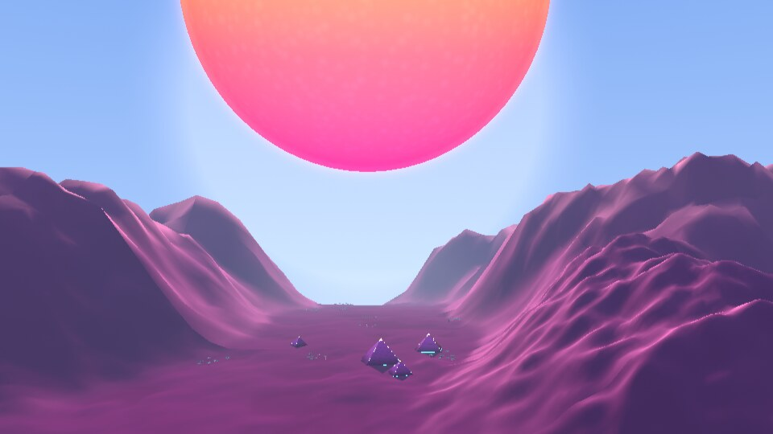<br><sub><b>Pyramids, <code>CAM_2</code></b>: the pyramid hero shot by day, with haze between the hills.</sub></td>
<td>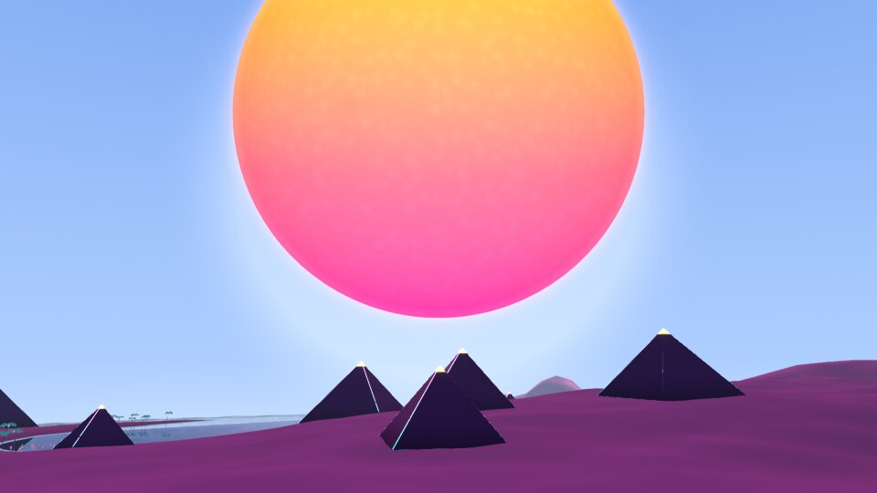<br><sub><b>Far pyramids, <code>CAM_9</code></b>: a pyramid group far from the valley, the sun behind it.</sub></td>
</tr>
<tr>
<td>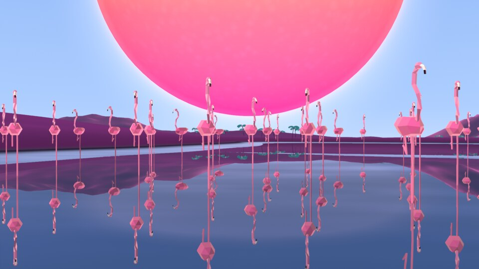<br><sub><b>Flamingos, <code>CAM_7</code></b>: a flock on the water next to the pyramids, low, looking toward the sun (<code>/vj/flamingos</code> sets the flock size).</sub></td>
<td>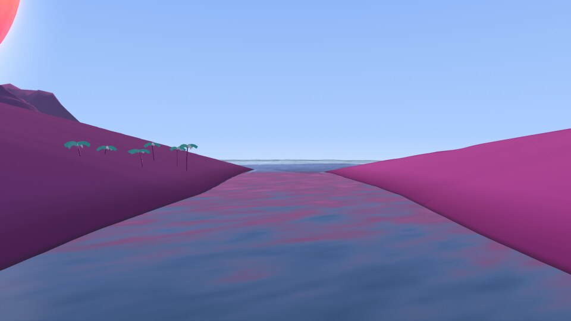<br><sub><b>River, <code>CAM_8</code></b>: a river running into the sea, looking downstream.</sub></td>
</tr>
<tr>
<td>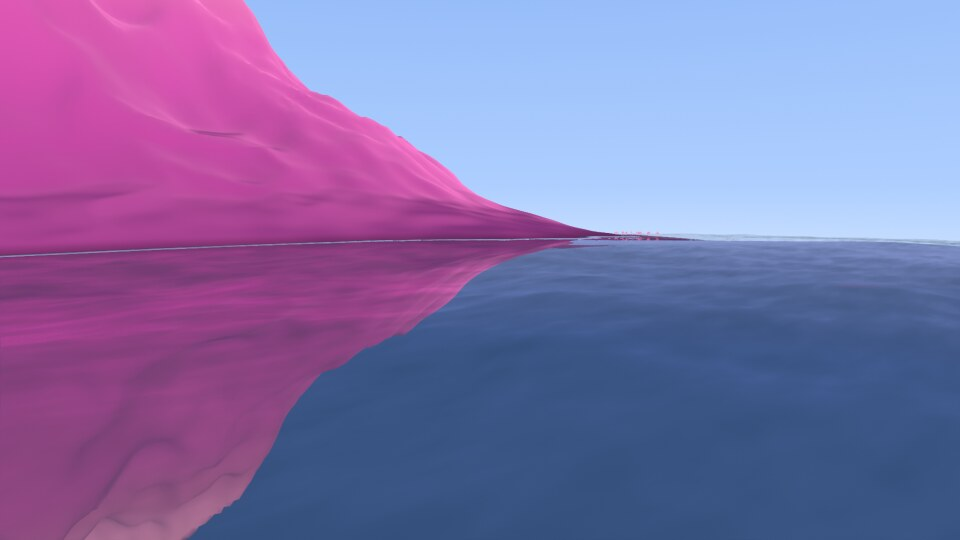<br><sub><b>Coast, <code>CAM_10</code></b>: a low pass along a coast with the sea on one side.</sub></td>
<td>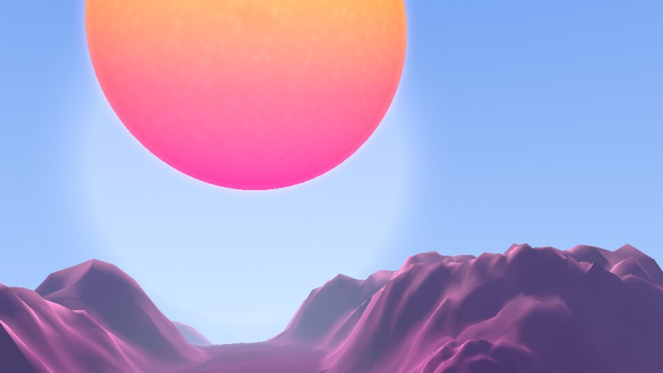<br><sub><b>Sun over the hills, <code>CAM_3</code></b>: tilted up over the pyramids (at night this camera looks at the moon).</sub></td>
</tr>
<tr>
<td><br><sub><b>Orbit, <code>CAM_6</code></b>: the whole planet in frame, with the moon. Space is dark even when the planet's ground is in daylight.</sub></td>
<td>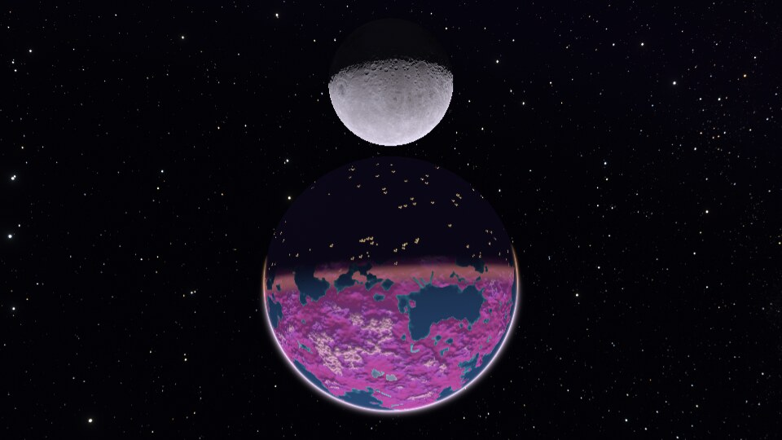<br><sub><b>Flight shot, <code>CAM_11</code></b>: the camera flying over the planet, at night with <code>/vj/grid</code> 0.</sub></td>
</tr>
</table>

These are 960x540 review grabs from the planet's look rounds 11 and 12, not all from the same build, and they are not a promise of how every frame looks. The night shot has no matching frame with `/vj/grid` 0 of the same framing, and there is no sunset or fog frame yet.

## The Godot scene: Colossus

A giant (the Colossus) walks across an overcast plain at dusk. A small figure, the Wanderer, walks up to it and climbs it. The Colossus tries to shake it off, then falls, and a new Colossus appears. One round of this is called an Arc: Approach, Climb, Fall, Reset. The terms are in [GLOSSARY.md](GLOSSARY.md).

The music drives the weight of the scene: `/vj/bass` sets how heavy each footfall is (camera shake, size of the dust), `/vj/beat` times the footfalls, dust puffs and cut points, `/vj/level` is the sun glow through the clouds, `/vj/intensity` the exposure. `/vj/shock` makes the Colossus shake while the Wanderer is on it. Without any OSC the scene runs on its own 90 BPM beat.

<table>
<tr>
<td width="50%">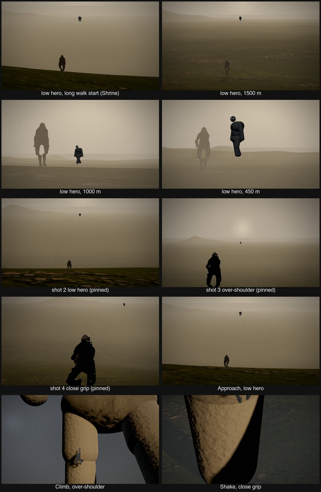</td>
<td width="50%">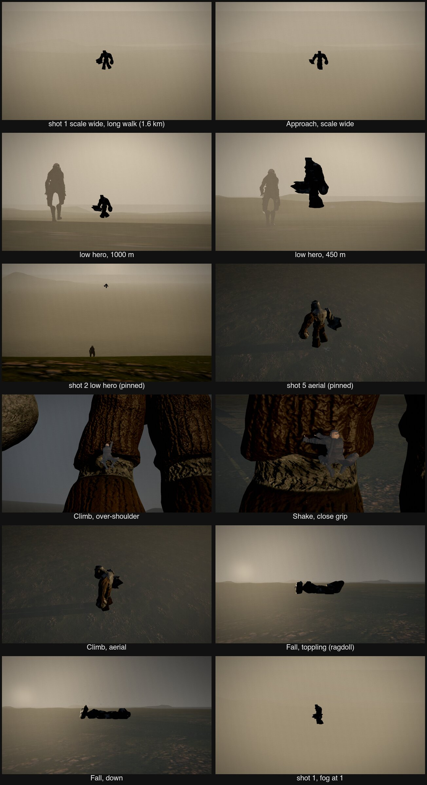</td>
</tr>
<tr>
<td align="center"><sub>The Wanderer, the figure that climbs.</sub></td>
<td align="center"><sub>The Colossi, one appears at a time.</sub></td>
</tr>
</table>

Screenshots of the running scene will follow. The character models are not in the repository (they come from downloads with their own licences); without them the scene runs with stand-ins. See [godot/colossus/assets/MODELS.md](godot/colossus/assets/MODELS.md) for what is needed and how to rebuild them.

## All OSC channels

Any OSC sender can drive a scene: send one float per message to udp 127.0.0.1:9201, for example `/vj/fog 0.8`. A value is 0 to 1 unless the row says otherwise; each scene scales it to its own range. Without Magic you can try every channel by hand on the scene's control page: http://127.0.0.1:9210 for Blender, http://127.0.0.1:9211 for Godot. The table below is made from [osc/contract.json](osc/contract.json) (`make osc-sync`); the exact numbers per scene are in [osc/CONTROLS.md](osc/CONTROLS.md). A picture shows a channel at a low and a high value where one has been taken; an empty cell means none yet.

<!-- osc-manual:begin -->
<details open>
<summary><b>Light and colour</b> (6)</summary>

| Address | What you see | Wire | Scene | Picture |
|---|---|---|---|---|
| `/vj/level` | The sun and its glow get stronger the louder the music is. | 0..1, default 0.5 | both |  |
| `/vj/bass` | Bass makes things hit harder: the glowing ground net and waterline in Blender, the shake and dust of each footfall in Godot. | 0..1, default 0 | both |  |
| `/vj/beat` | Pulses on every beat: pyramid edges, stars and water glints in Blender, footfalls and dust puffs in Godot. | 0..1, default 0 | both |  |
| `/vj/hue` | Turns all colours around the colour wheel. | 0..1, default 0 | Blender |  |
| `/vj/intensity` | Makes the whole picture brighter or darker. | 0..1, default 0.5 | both |  |
| `/vj/strobe` | Flashes the picture to white; higher means a stronger flash. | 0..1, default 0 | Blender |  |

</details>

<details>
<summary><b>Sky, sun and moon</b> (8)</summary>

| Address | What you see | Wire | Scene | Picture |
|---|---|---|---|---|
| `/vj/sun` | Lifts the sun up the sky and makes it bigger; 0 sinks it below the horizon. | 0..1, default 1 | Blender |  |
| `/vj/moon` | Makes the moon bigger or smaller. | 0..1, default 1 | Blender |  |
| `/vj/moon_phase` | Changes the shape of the moon from new through half to full. | 0..1, default 1 | Blender |  |
| `/vj/stars` | Fades the stars in or out. | 0..1, default 1 | Blender |  |
| `/vj/night` | Turns day into night: 0 is day, a quarter is sunset, half is twilight, 1 is night. | 0..1, default 0 | Blender |  |
| `/vj/nebula` | Fades in the coloured cloud in the night sky. | 0..1, default 1 | Blender |  |
| `/vj/eclipse` | Lines the moon up with the sun and the planet for an eclipse. | 0..1, default 0 | Blender |  |
| `/vj/star_speed` | Makes the stars drift across the sky. | 0..1, default 0 | Blender |  |

</details>

<details>
<summary><b>Ground, water and things on it</b> (5)</summary>

| Address | What you see | Wire | Scene | Picture |
|---|---|---|---|---|
| `/vj/grid_speed` | Makes the glowing grid on the ground scroll faster. | 0..1, default 0.15 | Blender |  |
| `/vj/pyramids` | Makes the pyramids rise out of the ground. | 0..1, default 1 | Blender |  |
| `/vj/grid` | Shows the real triangle edges of the ground as a glowing net at night; by day there is none. | 0..1, default 1 | Blender |  |
| `/vj/water` | Turns the reflections on the water up or down. | 0..1, default 1 | Blender |  |
| `/vj/flamingos` | Makes the flock of flamingos bigger; 0 hides it. | 0..1, default 1 | Blender |  |

</details>

<details>
<summary><b>Fog</b> (9)</summary>

| Address | What you see | Wire | Scene | Picture |
|---|---|---|---|---|
| `/vj/fog` | More fog near the ground; at 1 it is dense autumn fog. | 0..1, default 0.35 | both |  |
| `/vj/fog_height` | Makes the fog bank taller or lower. | 0..1, default 0.41 | both |  |
| `/vj/fog_glow` | Makes the fog glow by itself. | 0..1, default 0.3 | Blender |  |
| `/vj/fog_hue` | Tints the fog pink, violet or cyan. | 0..1, default 0 | Blender |  |
| `/vj/fog_noise` | Makes the fog patchier. | 0..1, default 0.6 | Blender |  |
| `/vj/fog_scale` | Makes the fog clouds bigger or smaller. | 0..1, default 0.25 | Blender |  |
| `/vj/fog_speed` | Makes the wind push the fog along faster. | 0..1, default 0.25 | Blender |  |
| `/vj/fog_beat` | Makes the fog pump with the beat. | 0..1, default 0.5 | Blender |  |
| `/vj/haze` | Adds or removes the soft haze toward the horizon. | 0..1, default 1 | both |  |

</details>

<details>
<summary><b>Camera and Flight</b> (6)</summary>

| Address | What you see | Wire | Scene | Picture |
|---|---|---|---|---|
| `/vj/cam` | Cuts to camera number N; 0 is the first shot. | integer 0..11, default 0 | both |  |
| `/vj/cam_speed` | Makes the camera drift and fly faster or slower. | 0..1, default 0.25 | Blender |  |
| `/vj/flight` | Steers the flying camera: 0 high orbit, then a landing approach, a skim over the mountains, and at 1 a hover over the water. | 0..1, default 0 | Blender |  |
| `/vj/boost` | Gives the flying camera a burst of speed with a wider view. | 0..1, default 0 | Blender |  |
| `/vj/blend` | Makes a camera change fly smoothly to the new shot; 0 cuts at once. | 0..1, default 0.5 | Blender |  |
| `/vj/energy` | Makes the camera move harder, from a slow wide glide to faster, tighter moves. | 0..1, default 0.3 | Blender |  |

</details>

<details>
<summary><b>Triggers</b> (3)</summary>

| Address | What you see | Wire | Scene | Picture |
|---|---|---|---|---|
| `/vj/shock` | A shock wave runs over the land once; in Godot the giant shakes while the Wanderer is on it. | trigger 0..1.5, default 0 | both |  |
| `/vj/meteor` | A shooting star crosses the sky. | trigger 0..1, default 0 | Blender |  |
| `/vj/hit` | A quick surge of speed with a wide-angle kick on the camera. | trigger 0..1, default 0 | Blender |  |

</details>

<details>
<summary><b>Godot only</b> (1)</summary>

| Address | What you see | Wire | Scene | Picture |
|---|---|---|---|---|
| `/vj/cam_auto` | 1 lets the scene's director cut between shots by itself, 0 holds the shot that `/vj/cam` picks. | integer 0..1, default 1 | Godot |  |

</details>
<!-- osc-manual:end -->

## Try it

```bash
make help
```

Lists every command.

```bash
make blender-open
```

Opens the planet in Blender and waits until the start state is ready (runtime, bridge, Syphon, picture, night edges). Then open http://127.0.0.1:9210 to drive it by hand without Magic. Use `SCENE=island` for the older island scene.

```bash
make godot-open
```

Runs the Colossus scene in a window. Control page: http://127.0.0.1:9211. It refuses to start while Blender runs, because both use the same GPU and port.

```bash
make test
```

Runs all tests without a window or a GPU: the OSC contract, the Magic project tools, the Blender bridge and the Godot logic with a headless self-check.

For music, open [magic/projects/show.magic](magic/projects/show.magic) in Magic Performer. It sends to 127.0.0.1:9201 and shows both Syphon sources with a fader between them (`SceneMix`). `make lab` starts an optional debug relay and test page on http://127.0.0.1:8765, not needed for a show.

## Needs

- macOS on Apple Silicon, Blender 5.3 with `syphon-python` and PyObjC in `~/.local/lib/python3.13/site-packages`, Godot 4.7 (mono build at `/Applications/Godot_mono.app`), Magic Music Visuals Performer, ImageMagick for contact sheets, gdtoolkit for `make godot-lint`, `make venv` for the verify scripts (numpy and Pillow).
- Star maps for the planet sky are not in git: NASA SVS Deep Star Maps 2020 into `blender/scenes/planet_proto/starmaps/`.

## Read next

- Agents and contributors: [AGENTS.md](AGENTS.md), then [STATE.md](STATE.md).
- The addresses: [osc/CONTROLS.md](osc/CONTROLS.md).
- Terms: [GLOSSARY.md](GLOSSARY.md).
- The scenes: [blender/README.md](blender/README.md), [godot/colossus/README.md](godot/colossus/README.md).
