# bossi3dj

Live visuals for music. A 3D scene reacts to the sound, and you mix its picture on a projector or screen. To run a show, read the [handbook](docs/handbook.md).

How it works, in four steps:

1. Music goes into **Magic Music Visuals** (Magic), a VJ program.
2. Magic turns it into about 40 simple numbers, for example *louder*, *bass*, *beat*, *night*, *fog*, *which camera*. Every number is a row in [osc/contract.json](osc/contract.json) and goes out as an OSC message named `/vj/<name>` (OSC is a small network message format).
3. One 3D scene reads the numbers and moves, glows and changes. Two scenes exist: a **Blender** scene and a **Godot** scene. Only one runs at a time, so both listen on the same port, udp 9201.
4. The scene publishes its picture as a **Syphon** video stream (a way for Mac apps to share frames). Magic picks it up, adds effects and mixes the two scenes.

The scenes hold no music logic. Magic decides what the music means, the scenes only take the numbers.

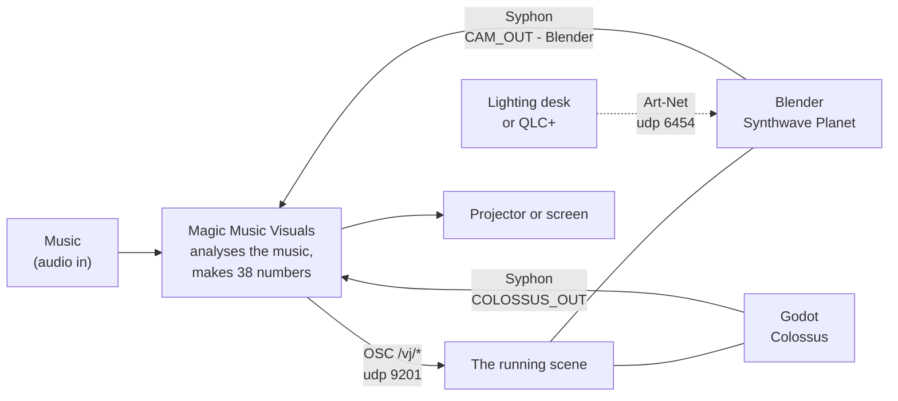

| Scene | Engine | Folder | What you see |
|---|---|---|---|
| Synthwave Planet | Blender 5.3 (EEVEE), built by script | [blender/](blender/) | a retro planet with pink and lilac hills, pyramids, water, flamingos, stars and a moon |
| Colossus | Godot 4.7 (Forward+, Metal) | [godot/colossus/](godot/colossus/) | an overcast dusk plain, a giant, and a small figure that climbs it |

## The Blender scene: Synthwave Planet

A whole small planet with a sun, a moon and a star sky. One camera, the Path Camera, flies over it: you pick a path (how it moves), a target (what it looks at) and a height from just over the ground to space. The names are under `/vj/path` and `/vj/target` in [All OSC channels](#all-osc-channels). The music changes the light, the weather and where the camera goes:

- `/vj/night` moves the time of day: 0 is day, 0.25 sunset, 0.5 twilight, 1 night.
- `/vj/fog` sets how dense the fog bank is. Fog has its own colour, glow, size and wind (`/vj/fog_*`).
- `/vj/path`, `/vj/target` and `/vj/height` steer the camera; a change flies over in the fade time `/vj/blend` (0 cuts). `/vj/energy` sets how hard the camera moves.
- A control you touch stays yours for `/vj/takeover` (20 s by default), then the music steers it again.
- `/vj/grid` shows the real triangle edges of the ground at night as a glowing cyan net. By day there are none.
- `/vj/level`, `/vj/bass` and `/vj/beat` pulse the sun, the net, the pyramid edges and the water glints with the music. `/vj/hue` turns the whole palette.

The full list with ranges is in [osc/CONTROLS.md](osc/CONTROLS.md).

<table>
<tr>
<td width="50%">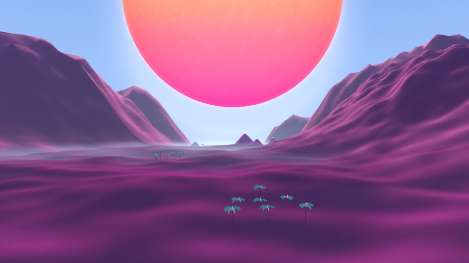<br><sub><b>Day, <code>CAM_0</code></b>: wide, up the plaza toward the pyramids and the sun (<code>/vj/night</code> 0).</sub></td>
<td width="50%">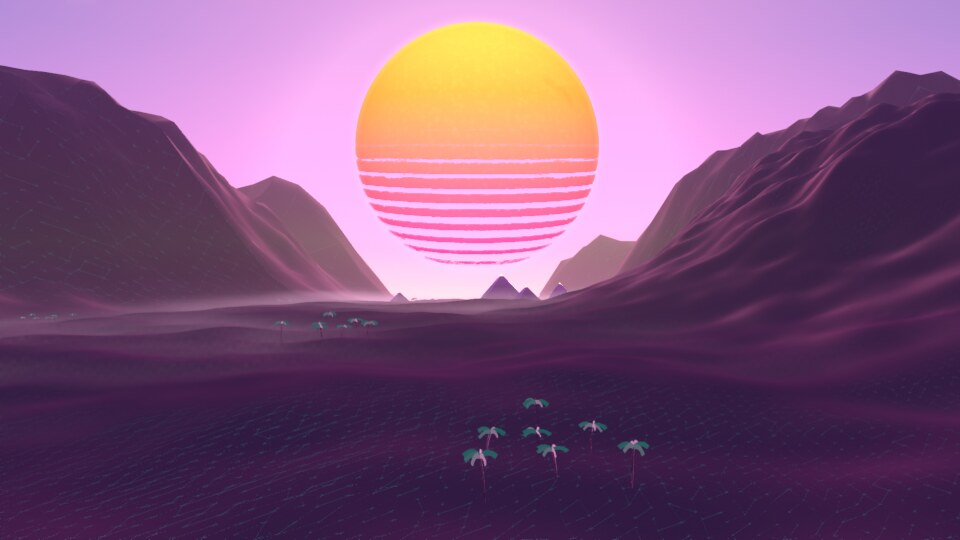<br><sub><b>Sunset, <code>CAM_0</code></b>: the same view at <code>/vj/night</code> 0.3.</sub></td>
</tr>
<tr>
<td width="50%">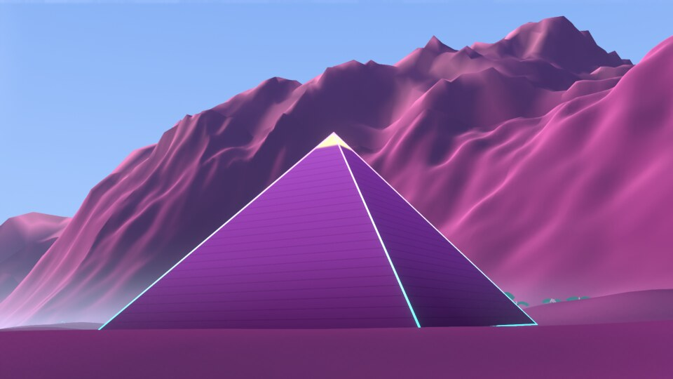<br><sub><b>Pyramid hero, <code>CAM_2</code></b>: close and low in front of the pyramids, by day.</sub></td>
<td width="50%">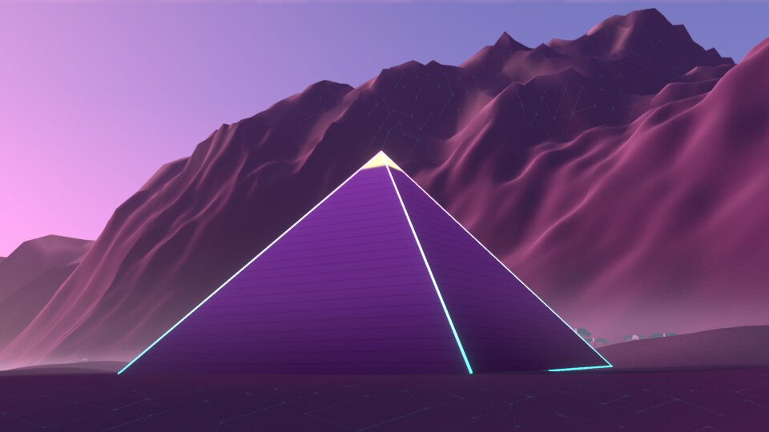<br><sub><b>Sunset, <code>CAM_2</code></b>: the same shot at <code>/vj/night</code> 0.3.</sub></td>
</tr>
<tr>
<td width="50%">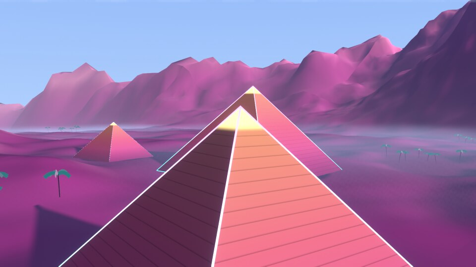<br><sub><b>Pyramid orbit, <code>CAM_5</code></b>: circles the pyramids above the ground; this is one moment of its path.</sub></td>
<td width="50%">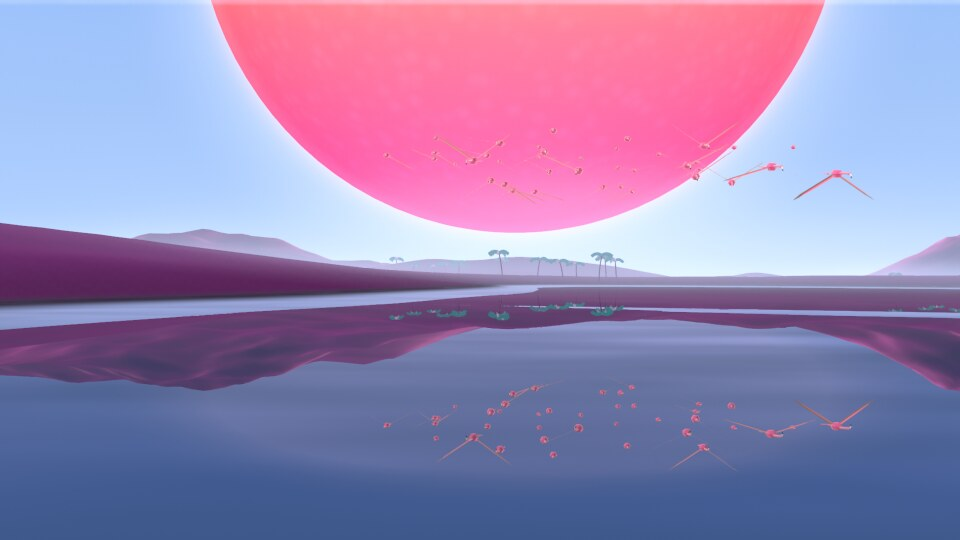<br><sub><b>Flamingos, <code>CAM_7</code></b>: a flock on the lake next to the pyramids, looking toward the sun (<code>/vj/flamingos</code> sets the flock size).</sub></td>
</tr>
<tr>
<td width="50%">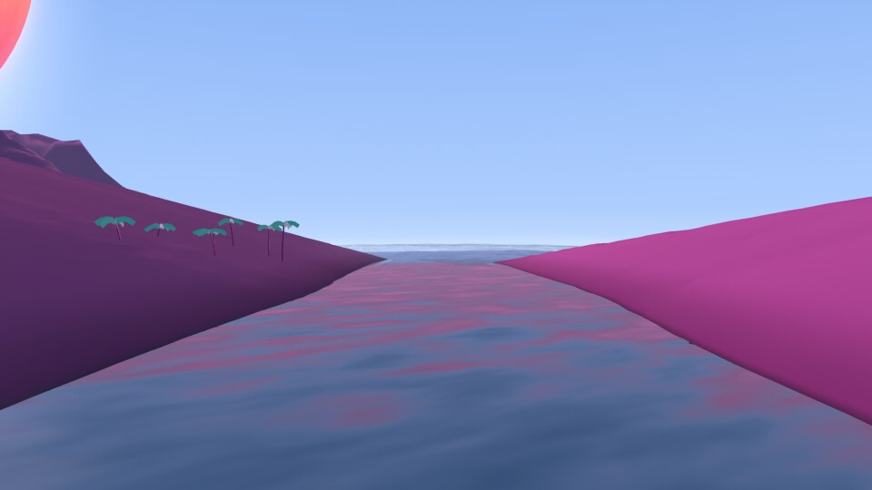<br><sub><b>River, <code>CAM_8</code></b>: a river running into the sea, looking downstream.</sub></td>
<td width="50%">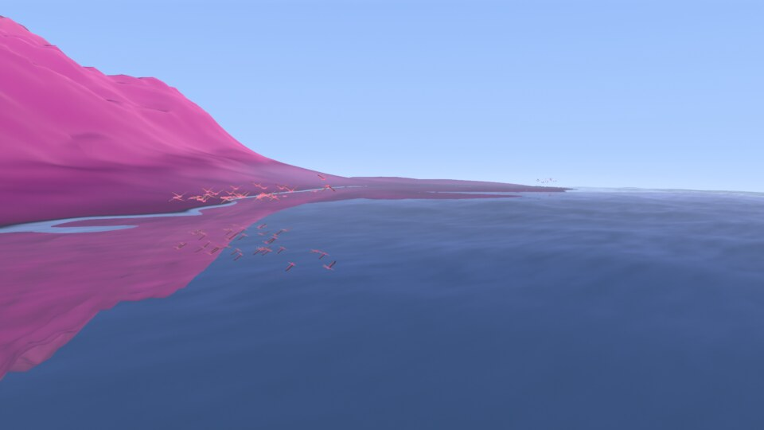<br><sub><b>Coast, <code>CAM_10</code></b>: a low pass along a coast with the sea on one side; one moment of its path.</sub></td>
</tr>
<tr>
<td width="50%">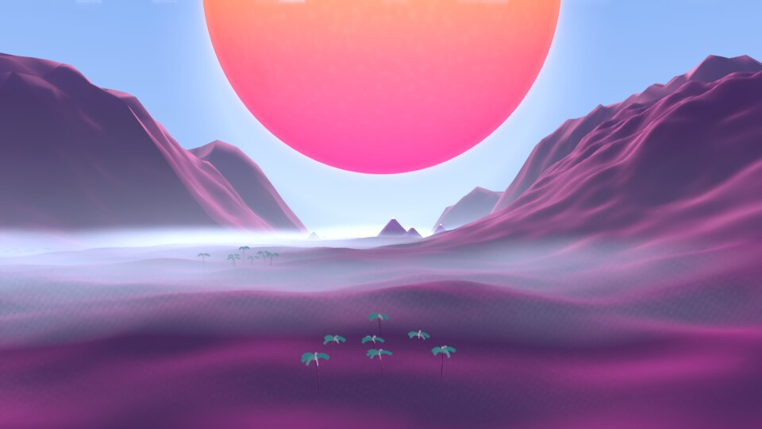<br><sub><b>Fog, <code>CAM_0</code></b>: <code>/vj/fog</code> 0.9 by day.</sub></td>
<td width="50%">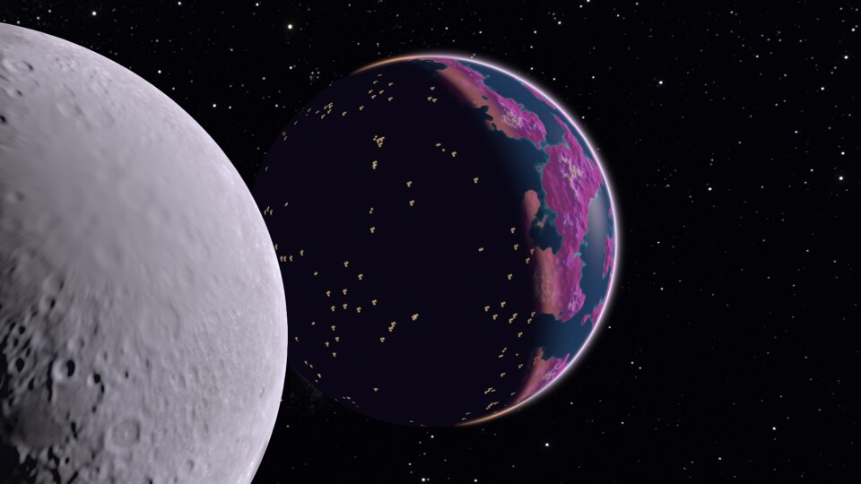<br><sub><b>Orbit, <code>CAM_6</code></b>: the whole planet in frame with the moon, mostly on its dark side.</sub></td>
</tr>
<tr>
<td width="50%">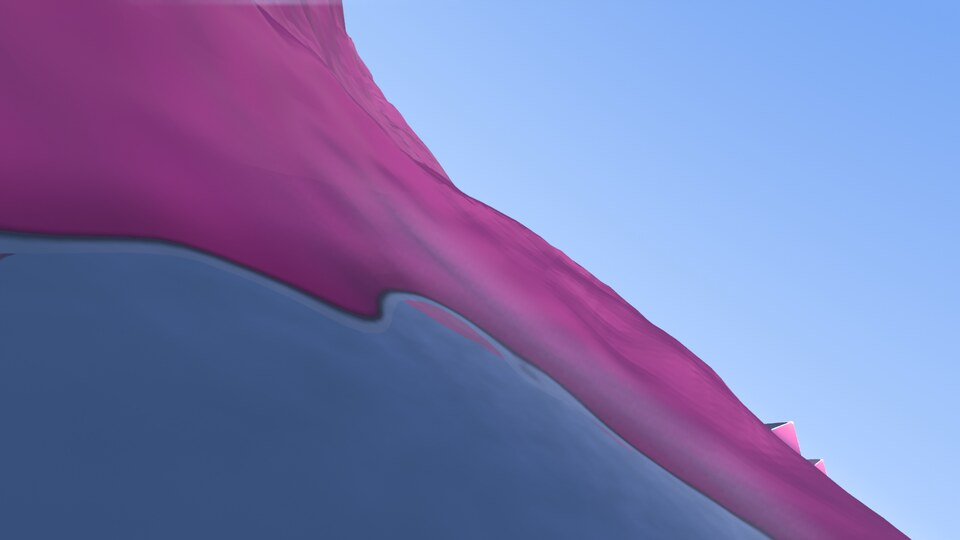<br><sub><b>Flight, <code>CAM_11</code></b>: the Flight shot at the Skim stage skimming over the mountains, one moment of its path.</sub></td>
<td width="50%"><sub><b>The Path Camera</b> replaces these shots. The Flight became the path "Follow the land" at a low height. Pictures of the Path Camera follow once it is built.</sub></td>
</tr>
<tr>
<td colspan="2">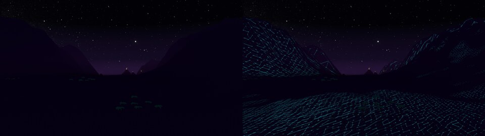<br><sub><b>Night, <code>CAM_0</code></b>: <code>/vj/night</code> 1, <code>/vj/grid</code> 0 on the left and 1 on the right. The cyan net is the ground's real triangle edges.</sub></td>
</tr>
</table>

These are 960x540 grabs of the build before the Path Camera (fixed shots `CAM_0` to `CAM_11`, gone since 2026-11-13), with the clocks frozen, one frame per picture; the controls not named are at their defaults. They show the look; the camera views come back as path and target pairs.

## The Godot scene: Colossus

> Status: parked since 2026-11-11. The scene runs and passes its checks, but its look is not where it should be. State and open tasks: [docs/handover/godot-parked.md](docs/handover/godot-parked.md).

A giant (the Colossus) walks across an overcast plain at dusk. A small figure, the Wanderer, walks up to it and climbs it. The Colossus tries to shake it off, then falls, and a new Colossus appears. One round of this is called an Arc: Approach, Climb, Fall, Reset. The terms are in [GLOSSARY.md](GLOSSARY.md).

The music drives the weight of the scene: `/vj/bass` sets how heavy each footfall is (camera shake, size of the dust), `/vj/beat` times the footfalls, dust puffs and cut points, `/vj/level` is the sun glow through the clouds, `/vj/intensity` the exposure. `/vj/shock` makes the Colossus shake while the Wanderer is on it. Without any OSC the scene runs on its own 90 BPM beat.

<table>
<tr>
<td width="50%">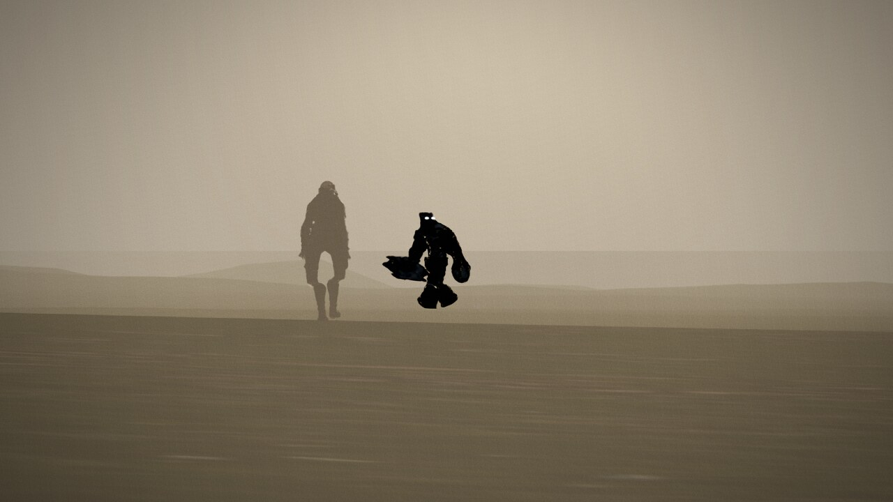<br><sub><b>Approach, Low Hero</b>: on the long walk, at 1000 m.</sub></td>
<td width="50%">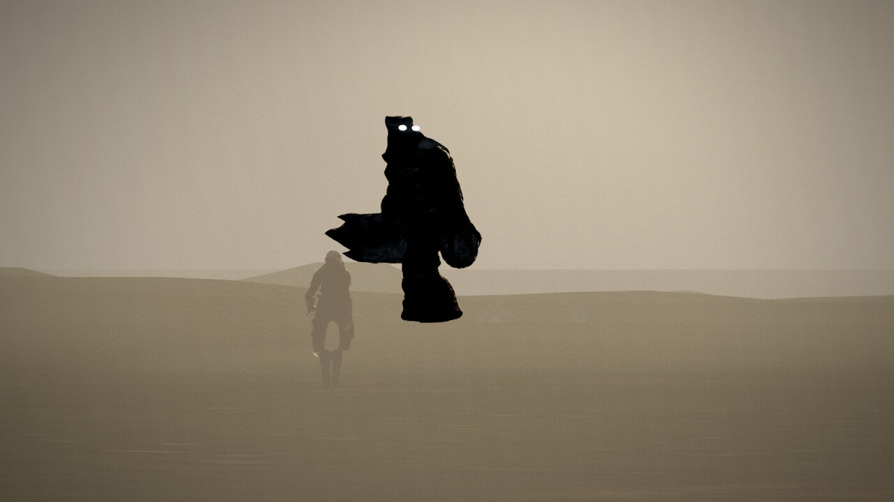<br><sub><b>Approach, Low Hero</b>: the same walk at 450 m.</sub></td>
</tr>
<tr>
<td width="50%">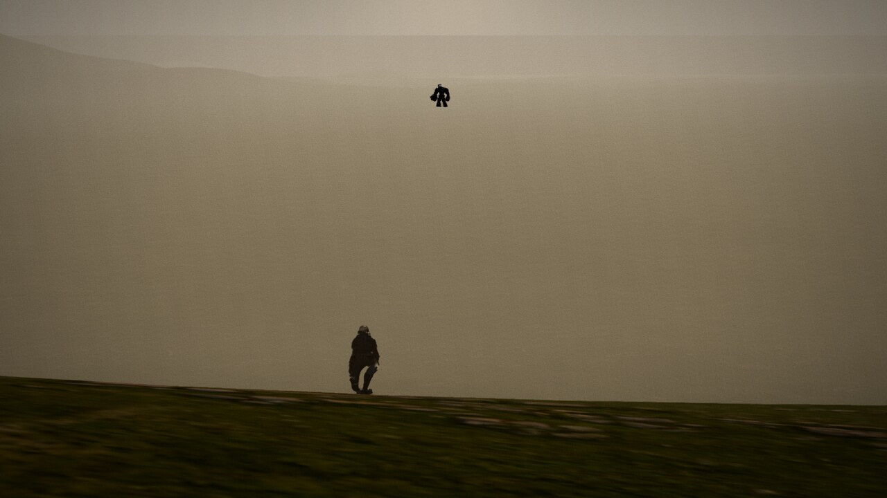<br><sub><b>Approach, Low Hero</b>: a low camera beside the Wanderer, looking up.</sub></td>
<td width="50%">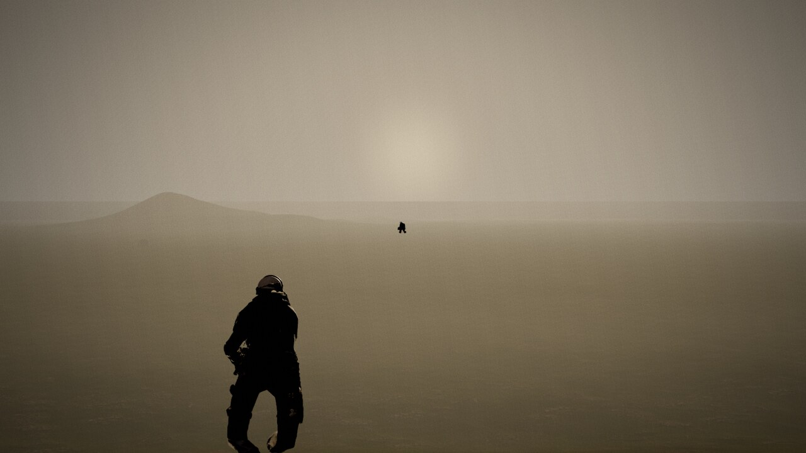<br><sub><b>Approach, Over Shoulder</b>.</sub></td>
</tr>
<tr>
<td width="50%">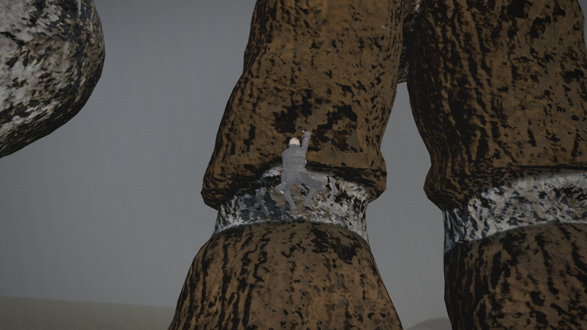<br><sub><b>Climb, Over Shoulder</b>: past the Wanderer up the Grab Path.</sub></td>
<td width="50%">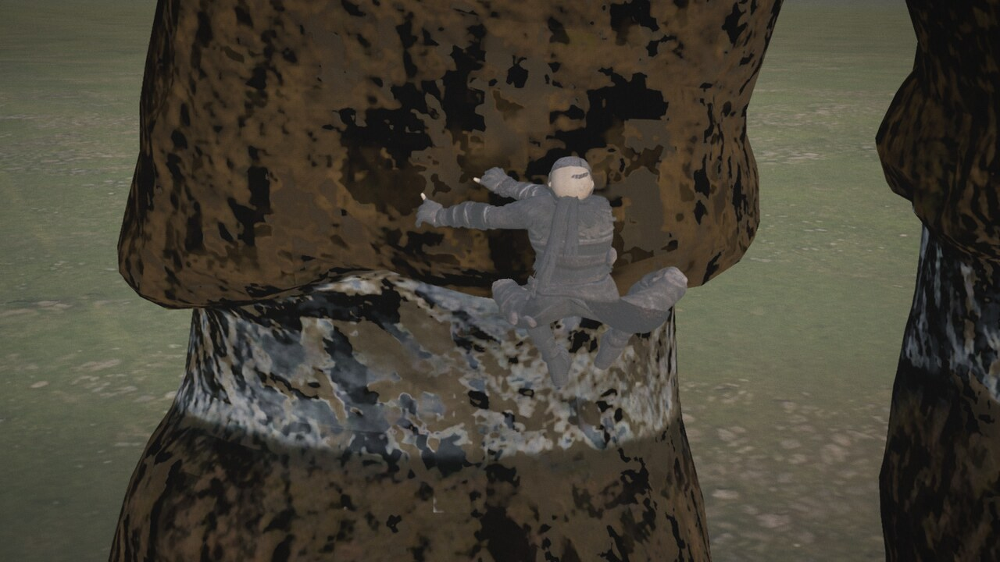<br><sub><b>Climb, Close Grip</b>: close on the hands at a Grab Point.</sub></td>
</tr>
<tr>
<td width="50%">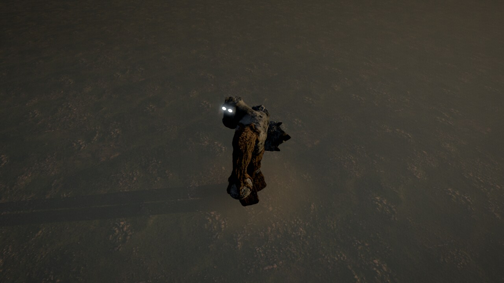<br><sub><b>Climb, Aerial</b>: circling the Colossus from above.</sub></td>
<td width="50%">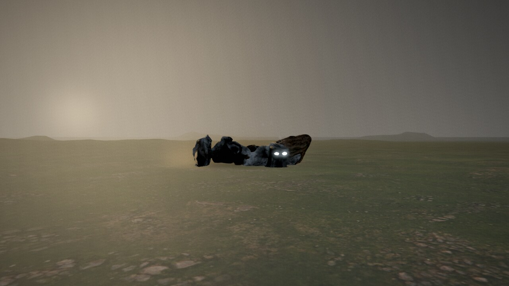<br><sub><b>Fall</b>: the Colossus toppling.</sub></td>
</tr>
</table>

Single frames from the Godot scene's picture rounds (1280 px; shot and Phase from the file names). The character models are not in the repository (they come from downloads with their own licences); without them the scene runs with stand-ins. See [godot/colossus/assets/MODELS.md](godot/colossus/assets/MODELS.md) for what is needed and how to rebuild them.

## All OSC channels

Any OSC sender can drive a scene: send one float per message to udp 127.0.0.1:9201, for example `/vj/fog 0.8`. A value is 0 to 1 unless the row says otherwise; each scene scales it to its own range. Without Magic you can try every channel by hand on the scene's control page: http://127.0.0.1:9210 for Blender, http://127.0.0.1:9211 for Godot. The table below is made from [osc/contract.json](osc/contract.json) (`make osc-sync`); the exact numbers per scene are in [osc/CONTROLS.md](osc/CONTROLS.md). A picture shows a channel at a low and a high value where one has been taken; an empty cell means none yet.

<!-- osc-manual:begin -->
<details open>
<summary><b>Light and colour</b> (6)</summary>

| Address | What you see | Wire | Scene | Picture |
|---|---|---|---|---|
| `/vj/level` | The sun and its glow get stronger the louder the music is. | 0..1, default 0.5 | both | 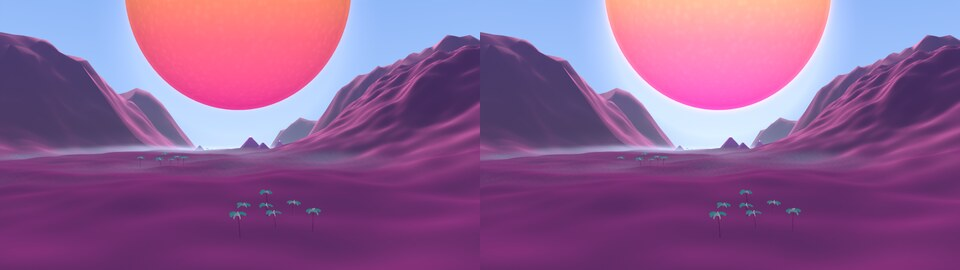<br><sub>Blender, low | high</sub><br>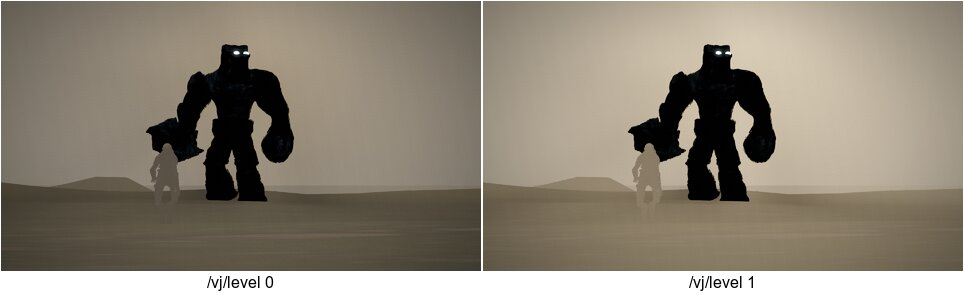<br><sub>Godot, low | high</sub> |
| `/vj/bass` | Bass makes things hit harder: the glowing ground net and waterline in Blender, the shake and dust of each footfall in Godot. | 0..1, default 0 | both | 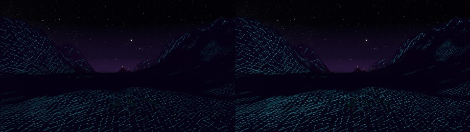<br><sub>Blender, low | high</sub> |
| `/vj/beat` | Pulses on every beat: pyramid edges, stars and water glints in Blender, footfalls and dust puffs in Godot. | 0..1, default 0 | both | 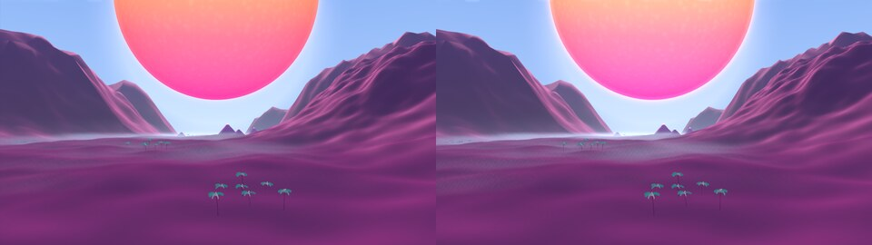<br><sub>Blender, low | high</sub> |
| `/vj/hue` | Turns all colours around the colour wheel. | 0..1, default 0 | Blender | 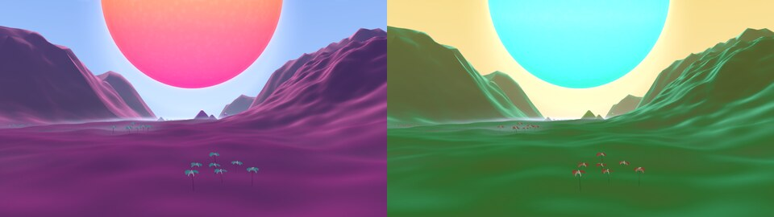<br><sub>Blender, low | high</sub> |
| `/vj/intensity` | Makes the whole picture brighter or darker. | 0..1, default 0.5 | both | 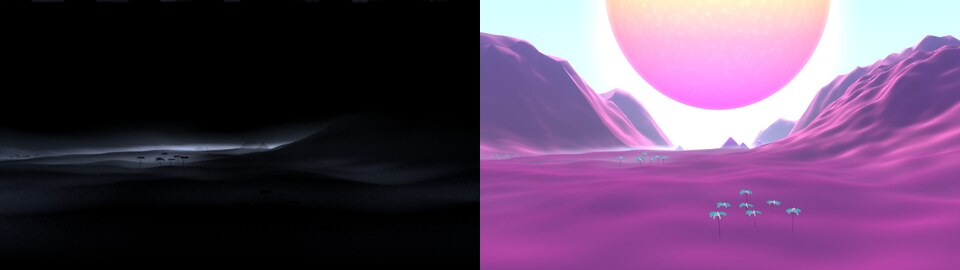<br><sub>Blender, low | high</sub><br>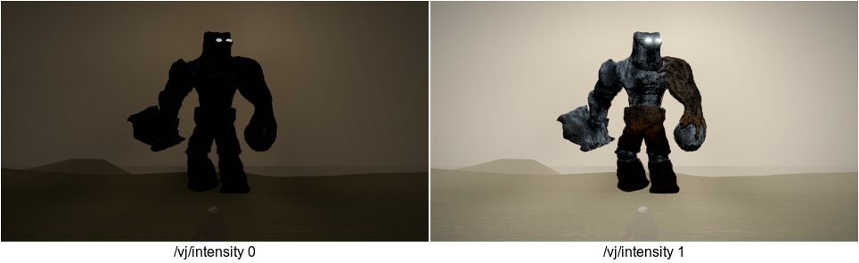<br><sub>Godot, low | high</sub> |
| `/vj/strobe` | Flashes the picture to white; higher means a stronger flash. | 0..1, default 0 | Blender | 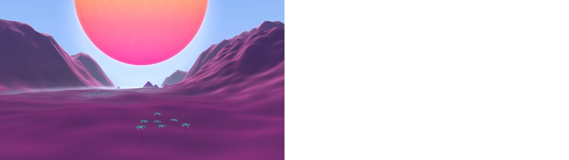<br><sub>Blender, low | high</sub> |

</details>

<details>
<summary><b>Sky, sun and moon</b> (8)</summary>

| Address | What you see | Wire | Scene | Picture |
|---|---|---|---|---|
| `/vj/sun` | Lifts the sun up the sky and makes it bigger; 0 sinks it below the horizon. | 0..1, default 1 | Blender | 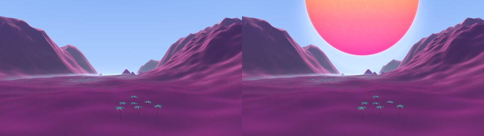<br><sub>Blender, low | high</sub> |
| `/vj/moon` | Makes the moon bigger or smaller. | 0..1, default 1 | Blender | 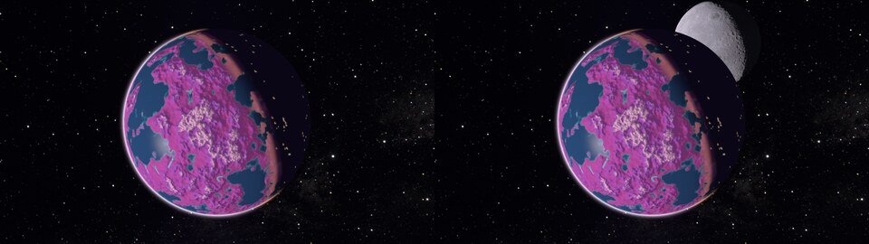<br><sub>Blender, low | high</sub> |
| `/vj/moon_phase` | Changes the shape of the moon from new through half to full. | 0..1, default 1 | Blender | 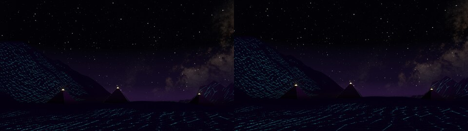<br><sub>Blender, low | high</sub> |
| `/vj/stars` | Fades the stars in or out. | 0..1, default 1 | Blender | 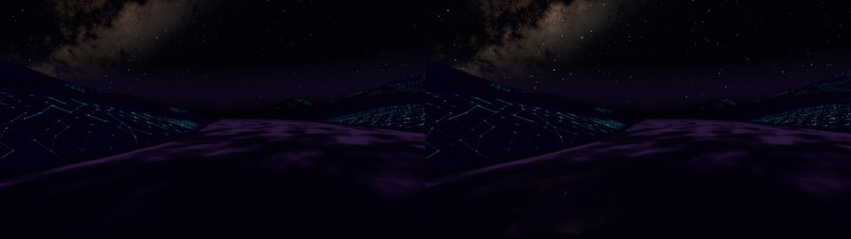<br><sub>Blender, low | high</sub> |
| `/vj/night` | Turns day into night: 0 is day, a quarter is sunset, half is twilight, 1 is night. | 0..1, default 0 | Blender | 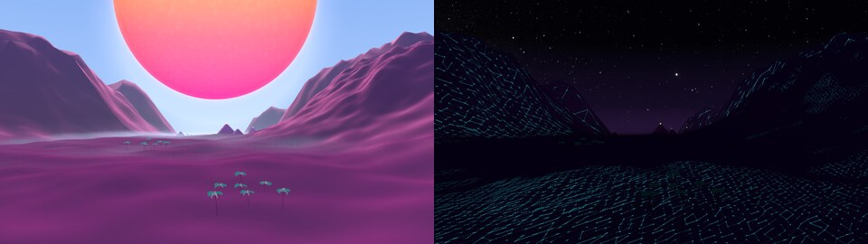<br><sub>Blender, low | high</sub> |
| `/vj/nebula` | Fades in the coloured cloud in the night sky. | 0..1, default 1 | Blender | 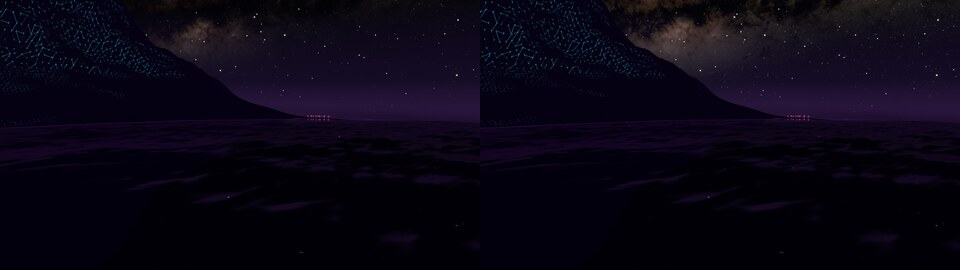<br><sub>Blender, low | high</sub> |
| `/vj/eclipse` | Lines the moon up with the sun and the planet for an eclipse. | 0..1, default 0 | Blender | 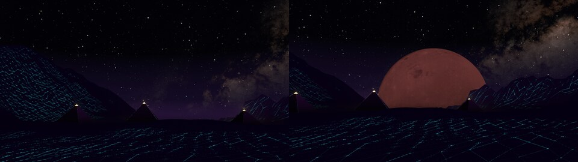<br><sub>Blender, low | high</sub> |
| `/vj/star_speed` | Makes the stars drift across the sky. | 0..1, default 0 | Blender | 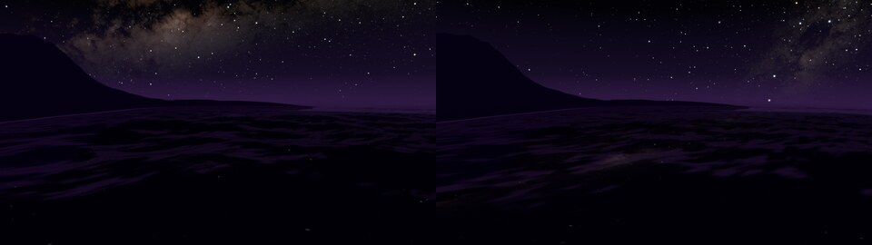<br><sub>Blender, low | high</sub> |

</details>

<details>
<summary><b>Ground, water and things on it</b> (5)</summary>

| Address | What you see | Wire | Scene | Picture |
|---|---|---|---|---|
| `/vj/grid_speed` | Makes the glowing grid on the ground scroll faster. | 0..1, default 0.15 | Blender |  |
| `/vj/pyramids` | Makes the pyramids rise out of the ground. | 0..1, default 1 | Blender | 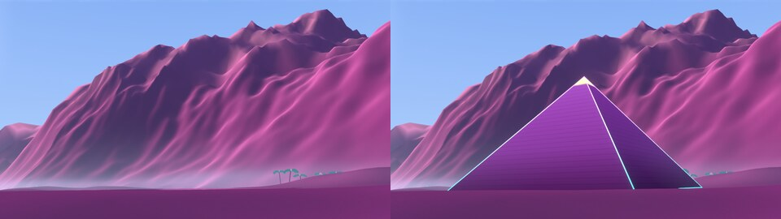<br><sub>Blender, low | high</sub> |
| `/vj/grid` | Shows the real triangle edges of the ground as a glowing net at night; by day there is none. | 0..1, default 1 | Blender | <br><sub>Blender, low | high</sub> |
| `/vj/water` | Turns the reflections on the water up or down. | 0..1, default 1 | Blender | 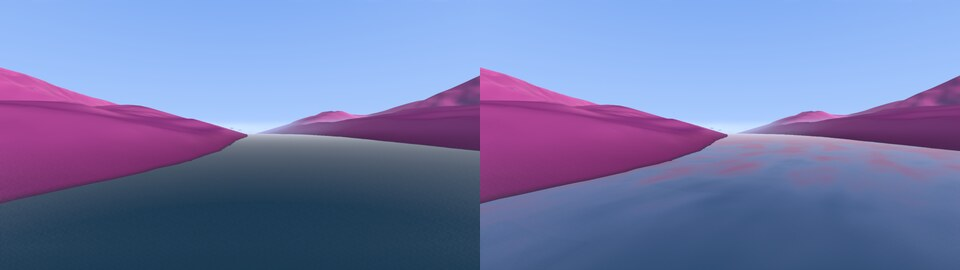<br><sub>Blender, low | high</sub> |
| `/vj/flamingos` | Makes the flock of flamingos bigger; 0 hides it. | 0..1, default 1 | Blender | 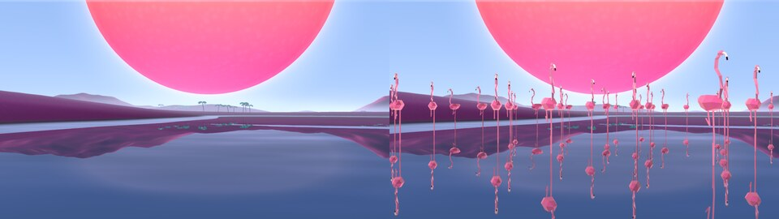<br><sub>Blender, low | high</sub> |

</details>

<details>
<summary><b>Fog</b> (9)</summary>

| Address | What you see | Wire | Scene | Picture |
|---|---|---|---|---|
| `/vj/fog` | More fog near the ground; at 1 it is dense autumn fog. | 0..1, default 0.35 | both | 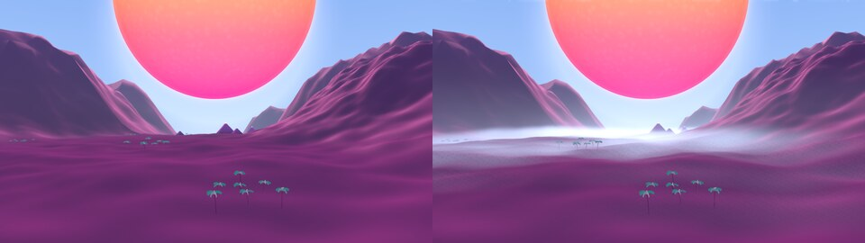<br><sub>Blender, low | high</sub><br>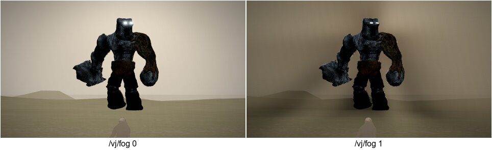<br><sub>Godot, low | high</sub> |
| `/vj/fog_height` | Makes the fog bank taller or lower. | 0..1, default 0.41 | both | 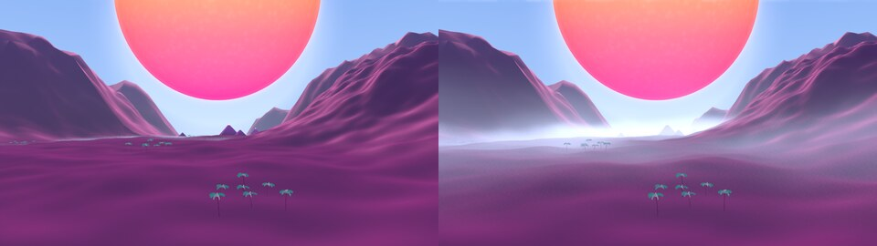<br><sub>Blender, low | high</sub><br>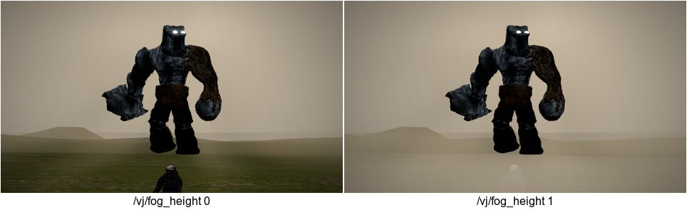<br><sub>Godot, low | high</sub> |
| `/vj/fog_glow` | Makes the fog glow by itself. | 0..1, default 0.3 | Blender | 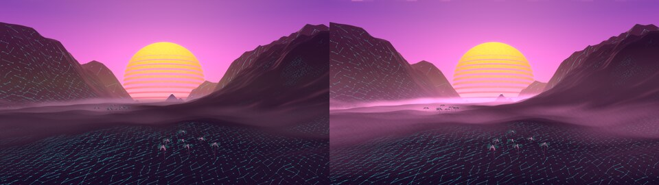<br><sub>Blender, low | high</sub> |
| `/vj/fog_hue` | Tints the fog pink, violet or cyan. | 0..1, default 0 | Blender | 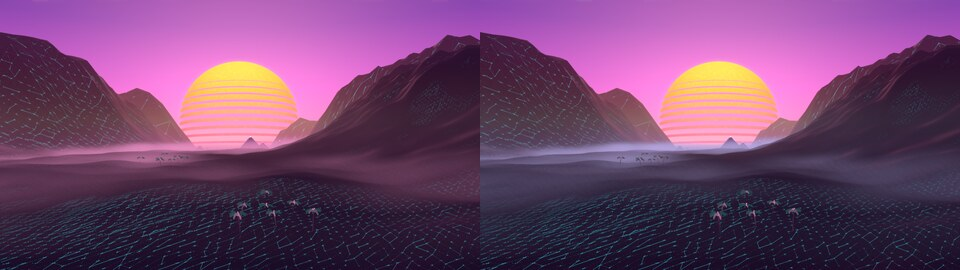<br><sub>Blender, low | high</sub> |
| `/vj/fog_noise` | Makes the fog patchier. | 0..1, default 0.6 | Blender | 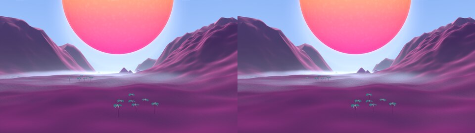<br><sub>Blender, low | high</sub> |
| `/vj/fog_scale` | Makes the fog clouds bigger or smaller. | 0..1, default 0.25 | Blender | 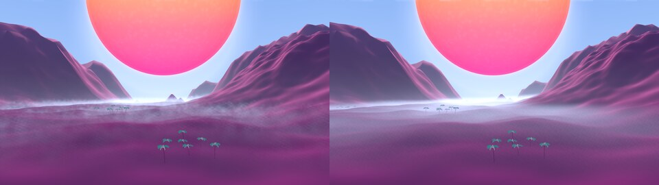<br><sub>Blender, low | high</sub> |
| `/vj/fog_speed` | Makes the wind push the fog along faster. | 0..1, default 0.25 | Blender | 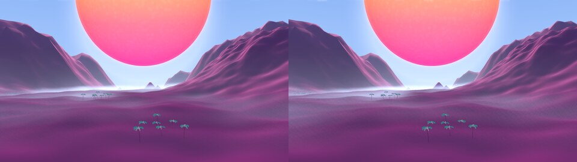<br><sub>Blender, low | high</sub> |
| `/vj/fog_beat` | Makes the fog pump with the beat. | 0..1, default 0.5 | Blender | 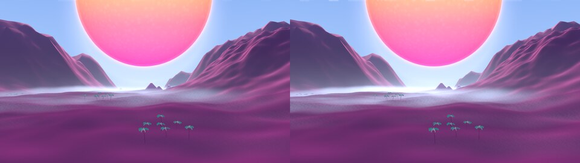<br><sub>Blender, low | high</sub> |
| `/vj/haze` | Adds or removes the soft haze toward the horizon. | 0..1, default 1 | both | <br><sub>Blender, low | high</sub><br><br><sub>Godot, low | high</sub> |

</details>

<details>
<summary><b>Camera</b> (7)</summary>

| Address | What you see | Wire | Scene | Picture |
|---|---|---|---|---|
| `/vj/cam_speed` | Makes the camera drift and fly faster or slower. | 0..1, default 0.25 | Blender | <br><sub>Blender, low | high</sub> |
| `/vj/path` | Picks how the camera moves: 0 orbit the target, 1 follow the land, 2 rise and descend, 3 vantage with a slow push. | integer 0..3, default 0 | Blender |  |
| `/vj/target` | Picks what the camera looks at: 0 pyramids, 1 lake, 2 river, 3 coast, 4 moon, 5 sun, 6 planet. | integer 0..6, default 0 | Blender |  |
| `/vj/height` | Lifts the camera from just over the ground (0) to space with the whole Planet in frame (1). | 0..1, default 0.3 | Blender |  |
| `/vj/blend` | How long a change of path or target flies; 0 cuts at once. | 0..1, default 0.5 | Blender | <br><sub>Blender, low | high</sub> |
| `/vj/takeover` | How long a control you touched stays yours before the music steers it again. | 0..1, default 0.33 | Blender |  |
| `/vj/energy` | Makes the camera move harder, from a slow wide glide to faster, tighter moves. | 0..1, default 0.3 | Blender | <br><sub>Blender, low | high</sub> |

</details>

<details>
<summary><b>Triggers</b> (3)</summary>

| Address | What you see | Wire | Scene | Picture |
|---|---|---|---|---|
| `/vj/shock` | A shock wave runs over the land once; in Godot the giant shakes while the Wanderer is on it. | trigger 0..1.5, default 0 | both | <br><sub>Blender, before | during</sub><br><br><sub>Godot, before | during</sub> |
| `/vj/meteor` | A shooting star crosses the sky. | trigger 0..1, default 0 | Blender | <br><sub>Blender, before | during</sub> |
| `/vj/hit` | A quick surge of speed with a wide-angle kick on the camera. | trigger 0..1, default 0 | Blender | <br><sub>Blender, before | during</sub> |

</details>

<details>
<summary><b>Godot only</b> (2)</summary>

| Address | What you see | Wire | Scene | Picture |
|---|---|---|---|---|
| `/vj/cam` | Cuts to camera number N; 0 is the first shot. | integer 0..11, default 0 | Godot | <br><sub>Godot, the shots</sub> |
| `/vj/cam_auto` | 1 lets the scene's director cut between shots by itself, 0 holds the shot that `/vj/cam` picks. | integer 0..1, default 1 | Godot |  |

**Cameras for `/vj/cam`**: the number picks the shot.

*Godot, Colossus*

| Number | Name | What it shows | Picture |
|---|---|---|---|
| 0 | Scale Wide | A telephoto view from behind the Wanderer that shows the Colossus towering over him; used on the Approach and at the start of the Fall. |  |
| 1 | Low Hero | A low camera beside the Wanderer on the plain, looking up at the Colossus; used on the Approach and now and then on the Climb. |  |
| 2 | Over Shoulder | Looks from the Colossus's surface past the Wanderer up the Grab Path; used on the Climb. |  |
| 3 | Close Grip | Close on the Wanderer's hands at a Grab Point; used on the Climb, cut to at every Shake, and on the Fall. |  |
| 4 | Aerial | Circles the Colossus from above; cut to at a drop. |  |


</details>
<!-- osc-manual:end -->

## Try it

```bash
make help
```

Lists every command.

```bash
make blender-open
```

Opens the planet in Blender and waits until the start state is ready (runtime, bridge, Syphon, picture, night edges). Then open http://127.0.0.1:9210 to drive it by hand without Magic. Use `SCENE=island` for the older island scene. A lighting desk or QLC+ can drive the planet over Art-Net too: [docs/artnet-qlc.md](docs/artnet-qlc.md).

```bash
make godot-open
```

Runs the Colossus scene in a window. Control page: http://127.0.0.1:9211. It refuses to start while Blender runs, because both use the same GPU and port.

```bash
make test
```

Runs all tests without a window or a GPU: the OSC contract, the Magic project tools, the Blender bridge and the Godot logic with a headless self-check.

For music, open [magic/projects/show.magic](magic/projects/show.magic) in Magic Performer. It sends to 127.0.0.1:9201 and shows both Syphon sources with a fader between them (`SceneMix`). `make lab` starts an optional debug relay and test page on http://127.0.0.1:8765, not needed for a show.

## Needs

- macOS on Apple Silicon, Blender 5.3 with `syphon-python` and PyObjC in `~/.local/lib/python3.13/site-packages`, Godot 4.7 (mono build at `/Applications/Godot_mono.app`), Magic Music Visuals Performer, ImageMagick for contact sheets, gdtoolkit for `make godot-lint`, `make venv` for the verify scripts (numpy and Pillow).
- Star maps for the planet sky are not in git: NASA SVS Deep Star Maps 2020 into `blender/scenes/planet_proto/starmaps/`.

## Read next

- Running a show: [docs/handbook.md](docs/handbook.md).
- Agents and contributors: [AGENTS.md](AGENTS.md), then [STATE.md](STATE.md).
- The addresses: [osc/CONTROLS.md](osc/CONTROLS.md).
- Terms: [GLOSSARY.md](GLOSSARY.md).
- The scenes: [blender/README.md](blender/README.md), [godot/colossus/README.md](godot/colossus/README.md).
