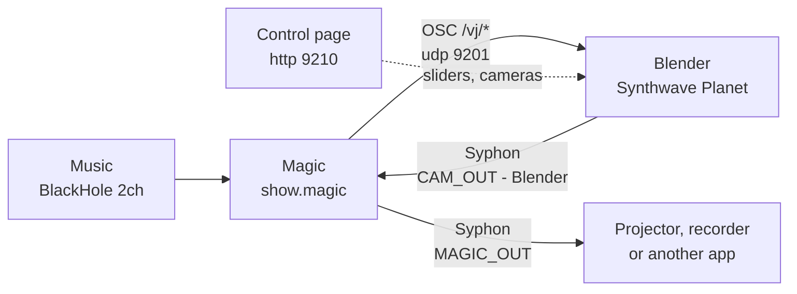

# Handbook: running the show

For the person who runs the show. The show is the Blender planet driven by Magic Music Visuals (Magic). Everything here is on one Mac. The Godot scene is parked and is not part of the show.



Magic listens to the music and turns it into 38 numbers. Blender reads them, moves the planet and sends its picture back to Magic. Magic adds effects and publishes the final picture. The control page lets you steer by hand, with or without Magic.

## What you need

- A Mac with Apple Silicon.
- Blender 5.3 at `/Applications/Blender.app` (the Makefile opens that path), with `syphon-python` and PyObjC in `~/.local/lib/python3.13/site-packages`. Without them there is no Syphon picture.
- Magic Music Visuals, the 3.0 beta: `/Applications/MagicBeta.app`. The project `magic/projects/show.magic` is saved in its format.
- BlackHole 2ch (`/Library/Audio/Plug-Ins/HAL/BlackHole2ch.driver`) as the audio input Magic listens to. The project reads the input named `BlackHole 2ch`.
- The star maps of the planet sky in `blender/scenes/planet_proto/starmaps/` (NASA SVS Deep Star Maps 2020, not in git). Without the maps the night sky draws magenta.
- Python 3 for the `make` commands (standard library only).

## Start a show

Order matters: Blender first, then Magic. Magic sends a value only when it changes, apart from the first 2 seconds after the project loads. If Blender is not up by then it misses the starting values.

1. Check that nothing runs. Anything listed under `blender_pids` or `godot_pids` must be closed first.

   ```bash
   make status
   ```

2. Send the music to BlackHole 2ch. In macOS Audio MIDI Setup make a Multi-Output Device with your speakers and BlackHole 2ch, and choose it as the output. Magic then hears what the Mac plays. This is a macOS setting, not part of the project.

3. Start the planet.

   ```bash
   make blender-open
   ```

   It opens Blender, waits for the scene and prints one line per check: runtime and playback, OSC bridge, night edges, Syphon sender, picture pixels, Syphon grab. Wait for `start state: ready`. A cold start can take minutes (the command waits up to 10 minutes). If it says `NOT ready`, see [When something is wrong](#when-something-is-wrong).

4. Open the show in Magic.

   ```bash
   open -a /Applications/MagicBeta.app magic/projects/show.magic
   ```

   Magic shows Blender's picture with its own effects (all off by default). The control page must now report OSC values coming from Magic: open http://127.0.0.1:9210 and look at the chip with the value sources. It reads `osc` and a count while Magic drives the scene. Magic can take about 20 seconds after it opens to start sending.

5. Play music. With no sound on the input Magic sends every control at its value (the defaults) and the camera stays on shot 0. With sound the music takes over the addresses listed in [What Magic sends and why](#what-magic-sends-and-why).

## What you see and how the music moves it

A planet with a sun, a moon, stars, pyramids, water, flamingos, fog and a set of named cameras. The loudness, the bass and the beat pulse the sun, the ground net, the pyramid edges and the water glints. Drops and builds in the music lift the brightness, flash the picture, change the camera and thicken the fog. Which address does what, with a picture at a low and a high value, is in [All OSC channels](../README.md#all-osc-channels) in the README. That table is made from `osc/contract.json` and is not repeated here.

The ground's net of edges only shows at night (`/vj/night` high) and only while `/vj/grid` is above 0. By day there are no lines, on purpose.

## Steer by hand

Two places, and the same rule in both.

**The hold rule.** A control takes whatever arrives last. When Magic sends a value for it, Magic's value overrides your slider. Magic sends a value only when it changes: a music-driven control (level, beat, intensity, fog, the camera cuts) is overwritten many times a second, a manual one (sun, moon, night, fog height and so on) is sent once and then stays where you put it. To stop Magic overriding a control, hold it: the **H** button next to it on the control page, or **Hold all**. A held control ignores incoming OSC. **Release all** gives Magic everything back.

### In Magic

Every address has a Global named like it: `/vj/fog_height` is `FogHeight`, `/vj/level` is `Level`. Set it by hand in Magic's Globals window. It holds the contract default at the start. Where the music drives the address, that Global is the value you get while no music plays and the base the music moves. The full list is in [What Magic sends and why](#what-magic-sends-and-why).

The Globals you reach for during a show:

| Global | Does |
|---|---|
| `React` | The music mapping on or off. 0: every address holds its control. 1: the music drives what it can. |
| `Auto` | Lets Magic direct builds, drops and breakdowns (brightness, fog, camera speed, flashes). |
| `Gain` | Input sensitivity. Raise it when the music is quiet. |
| `Blackout`, `Master` | Black the picture; overall brightness. |
| `CamAuto` | 1: Magic cuts the camera every 8 bars and on drops. 0: the shot picked by `Cam` stays. |
| `Cam` | The camera when `CamAuto` is 0, 0 to 1 over shots 0 to 11. |
| `CamCount` | How many shots the auto cutter cycles through. |
| `Drop`, `Shock`, `Meteor`, `Hit` | Pads. Set to 1 and back to 0 to fire a drop, a shock wave, a shooting star, a speed kick. |
| `Night`, `Fog`, `Sun`, `Moon`, `Hue` | The look. |
| `FxGlow`, `FxTrails`, `FxBlur`, `FxChroma`, `FxShake`, `FxKaleido` | Magic's own effects on the picture, all 0 by default. |
| `Monitor`, `Readout` | 1 draws the analysis meters, or the numbers Magic is sending, over the picture. Switch off before the picture goes out. |
| `SceneMix` | Blender against Godot. Leave it at 0. |

### On the control page

Open http://127.0.0.1:9210 on the Mac. It works at phone width too, one column.

- The top bar is always visible. It shows the scene, the camera on air with its number and name, the frame rate, whether Syphon frames are advancing, where the values come from (osc, page, sim, held), the Art-Net state (universe, start address, frames per second) and the result of the night-edge check.
- **On air**: one button per camera, number and name. Below them **Hold all**, **Release all** and **Reset** (tap twice) to put every control back to its default.
- **Presets**: type a name and Save to store the current values. A preset button sets those values again. Presets are kept in `blender/local/presets.json` on the Mac, so the phone and the laptop see the same ones. A recalled preset still obeys the hold rule.
- The sliders are grouped and ordered like the README manual. Each shows its address, a sentence on what you see change, its value in the scene's own units, the source of the last value, a reset to default (the round arrow) and **H**.
- Triggers (shock, meteor, hit) are buttons.
- **Tools**: **Check all** moves every control through its range, measures the picture and restores the defaults. All 37 controls take about 25 minutes; **Abort** stops it and restores the defaults. The beat simulator stands in for Magic's analysis (hold level, bass, beat and shock so Magic does not fight it). A live preview of the Syphon frame. **Incoming OSC** lists every address that arrives with its rate and sender.

**From a phone.** The page listens on the Mac only. To open it from a phone on the same network:

```bash
python3 tools/blender_page_lan.py on
```

Restart the scene (`make blender-kill`, then `make blender-open`). The command prints the address to open on the phone. While this is on, any device on that network can drive the scene. Take it back with `python3 tools/blender_page_lan.py off` and another restart.

## From a lighting desk (Art-Net, QLC+)

A lighting desk or QLC+ can drive the planet over Art-Net, next to Magic and the page. The scene listens on udp 6454 for one DMX universe. It has one DMX channel per address, so a fader on the desk is a slider on the page. The channel table and the QLC+ steps are in [docs/artnet-qlc.md](artnet-qlc.md), not repeated here.

The merge rule: a channel is applied only when its value changes. The desk sends every channel in every frame, so a resting fader never fights Magic or the page, and after a start the faders do nothing until you move them. The last change wins. The page's hold (**H**, or **Hold all**) stays above both Magic and the desk. The page's status bar shows the Art-Net state; the source of a value from the desk reads `artnet`.

## Cameras and the Flight

`/vj/cam` picks a shot by number. The planet has these (from `osc/contract.json`; pictures are in the README):

<!-- cameras:begin -->
| Number | Name | What it shows |
|---|---|---|
| 0 | Plaza View | A wide view from 70 m up, looking up the plaza toward the pyramids and the sun. It stands still. |
| 1 | River Skim | A low view 9 m over the nearest river, looking downstream along the water. It stands still. |
| 2 | Pyramid Hero | Close and low in front of the pyramids, the main pyramid shot. It stands still. |
| 3 | Moon Watch | Low among the hills, tilted up over the pyramids; at night it follows the moon. It stands still. |
| 4 | Pole Flyover | Flies a loop around the planet's pole over the hills, looking ahead along its path. |
| 5 | Pyramid Orbit | Circles the pyramids above the ground, always looking at them. |
| 6 | Planet Orbit | Circles the whole Planet from space, with the Planet and the moon in frame. |
| 7 | Flamingo Lake | Low over the water next to the pyramids, looking toward the sun, with the flamingo flock on the lake. It stands still. |
| 8 | River Mouth | Looks downstream along a river as it runs into the sea. It stands still. |
| 9 | Far Pyramids | A pyramid group far from the valley with the sun behind it. It stands still and follows the sun. |
| 10 | Coast Pass | A low pass along a coast, out over the water with the sea on one side, looking toward the land. |
| 11 | Flight | The flying camera: /vj/flight carries it from orbit down to the mountains and a hover over the water. |
<!-- cameras:end -->

Shot 11, the Flight, is a camera that flies by itself. `/vj/flight` steers it: 0 is a high orbit, then a landing approach, a skim over the mountains, and 1 a hover over the water. The control is damped on purpose: a jump flies, about a minute from end to end. `/vj/boost` gives it a burst of speed. `/vj/blend` sets how smoothly a cut flies to the new shot (0 cuts at once). The Flight only draws its streamed terrain while it is on air.

In Magic, set `CamAuto` to 0 and `Cam` to the shot you want. On the page, tap a camera button. If a camera jumps back after you set it, Magic's cutter is still on (`CamAuto` 1) or the control is not held.

## What Magic sends and why

One OSC sender per address, straight to the scene on udp 9201. Each sends 0 to 1; the scene scales it. Magic's own picture is published as Syphon `MAGIC_OUT - Magic` (1920x1080), so another app or `python3 magic/magicproj.py grab --server MAGIC_OUT` can take the final picture. The scene's server `CAM_OUT - Blender` is separate.

The table is generated from the project (`python3 magic/magic_manual.py sync`) and a test fails when it drifts. "follows" means the music moves the address while there is sound and `React` is above 0. Without sound every address sends its control, which holds the contract default.

<!-- magic-table:begin -->
| Address | Control Global | Default | Music | What the music does |
|---|---|---|---|---|
| `/vj/level` | `Level` | 0.5 | follows | Loudness against the track's own average, plus the beat. |
| `/vj/bass` | `Bass` | 0 | follows | Sub-bass against its recent average, plus the kick. |
| `/vj/beat` | `Beat` | 0 | follows | The beat clock: kick, or Synesthesia's onbeat on OSC in. |
| `/vj/hue` | `Hue` | 0 | follows | Walks on by HueDrift every bar and every drop. |
| `/vj/intensity` | `Intensity` | 0.5 | follows | Lifts on drops and builds, dips in breakdowns (Auto 1). |
| `/vj/strobe` | `Strobe` | 0 | follows | Flashes on the beat during a drop and on snare rolls in a build (Auto 1); Strobe adds a flash on every beat. |
| `/vj/grid_speed` | `GridSpeed` | 0.15 | follows | Faster with energy, drops and builds, slower in breakdowns. |
| `/vj/cam` | `Cam` | 0 | follows | The auto cutter: a new shot every 8 bars and on every drop, through the first CamCount shots (CamAuto 1). CamAuto 0 sends Cam. |
| `/vj/cam_auto` | `CamAuto` | 1 | no | Nothing: CamAuto 1 lets the cutter cut (Godot: its own director), 0 holds the shot Cam picks. |
| `/vj/cam_speed` | `CamSpeed` | 0.25 | follows | Faster on builds and drops, slower in breakdowns (Auto 1). |
| `/vj/sun` | `Sun` | 1 | no | Nothing, the control alone. |
| `/vj/moon` | `Moon` | 1 | no | Nothing, the control alone. |
| `/vj/moon_phase` | `MoonPhase` | 1 | no | Nothing, the control alone. |
| `/vj/pyramids` | `Pyramids` | 1 | no | Nothing, the control alone. |
| `/vj/grid` | `Grid` | 1 | no | Nothing, the control alone. |
| `/vj/stars` | `Stars` | 1 | no | Nothing, the control alone. |
| `/vj/water` | `Water` | 1 | no | Nothing, the control alone. |
| `/vj/night` | `Night` | 0 | no | Nothing, the control alone. |
| `/vj/nebula` | `Nebula` | 1 | no | Nothing, the control alone. |
| `/vj/shock` | `Shock` | 0 | follows | A wave on heavy kicks and on every drop (ShockKick 1); the Shock pad fires one now. |
| `/vj/meteor` | `Meteor` | 0 | no | Nothing: the Meteor pad fires one. |
| `/vj/flamingos` | `Flamingos` | 1 | no | Nothing, the control alone. |
| `/vj/fog` | `Fog` | 0.35 | follows | Thickens in a breakdown, up to 0.6 (Auto 1). |
| `/vj/fog_height` | `FogHeight` | 0.41 | no | Nothing, the control alone. |
| `/vj/fog_glow` | `FogGlow` | 0.3 | follows | Glows brighter on a drop (Auto 1). |
| `/vj/fog_hue` | `FogHue` | 0 | no | Nothing, the control alone. |
| `/vj/fog_noise` | `FogNoise` | 0.6 | no | Nothing, the control alone. |
| `/vj/fog_scale` | `FogScale` | 0.25 | no | Nothing, the control alone. |
| `/vj/fog_speed` | `FogSpeed` | 0.25 | no | Nothing, the control alone. |
| `/vj/fog_beat` | `FogBeat` | 0.5 | no | Nothing, the control alone. |
| `/vj/haze` | `Haze` | 1 | no | Nothing, the control alone. |
| `/vj/eclipse` | `Eclipse` | 0 | no | Nothing, the control alone. |
| `/vj/star_speed` | `StarSpeed` | 0 | no | Nothing, the control alone. |
| `/vj/flight` | `Flight` | 0 | no | Nothing, the control alone. |
| `/vj/boost` | `Boost` | 0 | no | Nothing, the control alone. |
| `/vj/blend` | `Blend` | 0.5 | no | Nothing, the control alone. |
| `/vj/energy` | `Energy` | 0.3 | no | Nothing, the control alone. |
| `/vj/hit` | `Hit` | 0 | no | Nothing: the Hit pad fires one. |
<!-- magic-table:end -->

## End the show

1. In Magic: close the project or quit. With no values arriving the scene falls back to its own idle pulse after 2 seconds.
2. On the page: **Release all**, and **Reset** if you want the defaults back.
3. Close Blender.

   ```bash
   make blender-kill
   ```

   Do not save the `.blend`. The scene files are generated, and the live values would be saved into them (`/api/health` lists such values as `off_default`).

## When something is wrong

Run `make status` first. It lists what runs, the scene's frame rate, Syphon, the OSC count and the machine load.

| Symptom | Likely cause | What to do |
|---|---|---|
| No picture in Magic, the program is black | Blender is not running, or its Syphon stalled: the page's Syphon chip says `stalled`, or `make status` shows no frames. Blender's 3D view left camera view, so it publishes nothing. | `make blender-open`. If Blender runs, `curl -s http://127.0.0.1:9210/api/health` lists the problem in `problems`. |
| The picture in Magic is black though Blender is fine | `Blackout` is above 0, or `SceneMix` is above 0 (that shows Godot, which is parked). | Set `Blackout` and `SceneMix` to 0 in Magic. |
| `make blender-open` says "a Blender is already running" | A Blender is open. Two Blenders halve the frame rate and fight for udp 9201. | `make blender-kill`, then `make blender-open`. |
| `make blender-open` says "a Godot window runs and shares the GPU" | The Godot scene is open and holds the GPU and port 9201. | `make godot-kill`, then `make blender-open`. |
| The sky is magenta | A star or moon map the scene points at is missing. | `make blender-paths` lists each file and whether it exists. Put the star maps in `blender/scenes/planet_proto/starmaps/`. |
| No night edges on the ground | By day there are none, on purpose. At night: `/vj/grid` is 0, or the scene opened without its edges. The start check row `night edges` says `missing` and `make blender-open` ends `NOT ready`. | Set `/vj/night` above 0.5 and `/vj/grid` to 1. The scene probes for its edges once at the start and repairs a blank build itself (the check says `repaired`). If the check says `missing`, run `make blender-kill` and `make blender-open` again; if it says `missing` twice, the notes are in [docs/handover/planet-edge-guard.md](handover/planet-edge-guard.md). |
| A slider snaps back | Magic sends a new value for that control. | Hold it (**H**) or **Hold all**. Set the Global in Magic instead. |
| The camera jumps back or cuts by itself | The auto cutter: `CamAuto` is 1 in Magic and music plays. | `CamAuto` 0 in Magic, or hold `vj_cam` on the page. |
| Port 9201 is busy, the bridge row of the start check fails | A second Blender, or the Godot scene, holds udp 9201. | `make status` shows what runs. `lsof -nP -iUDP:9201` names the process. Close the other one. |
| Magic runs but no values arrive: the page shows no `osc` source | Magic is still starting (it can take about 20 seconds after the project opens), the project was loaded before Blender was up, or it sends to another port. | Open the project in Magic again. `python3 magic/magicproj.py osc magic/projects/show.magic` lists each address with its target; every one must say 127.0.0.1:9201. The page's "Incoming OSC" list shows what arrives. |
| Low frame rate | The frame rate chip turns orange under 24. Another app uses the GPU, or the machine load is high: `make status` shows `load_1m` and `fps_trustworthy`. | Close other GPU apps (the Godot scene, a second Blender, screen recorders). Switch off Magic's `Fx*` effects. A frame rate read while the load is above 10 does not mean much. |
| The desk does nothing (Art-Net chip says `not listening`, `no frames yet` or `frames for another universe`) | The scene could not bind udp 6454 (another program has it), the desk sends another universe or start address than the scene listens on (the chip shows both), or QLC+ sends unicast to another machine. A channel also does nothing until its value changes once. | Check universe and start address on both sides, set the output to this Mac's address or to broadcast, and move the fader. Steps: [docs/artnet-qlc.md](artnet-qlc.md). |
| Bright green patches in the picture | A diagnosis left switched on by a session that worked on the scene, not part of the scene. | `make blender-kill`, then `make blender-open`. |
| The page does not load | Blender runs without the scene runtime (Auto Run Python Scripts was off), or Blender is not running. `make status` shows a Blender with `blender_scene: null`. From a phone: the page listens on the Mac only, so the phone gets no answer. | `make blender-kill`, `make blender-open`. For a phone, `python3 tools/blender_page_lan.py on`, then restart. |

When the start check fails the first time, read its rows: each names what failed.
