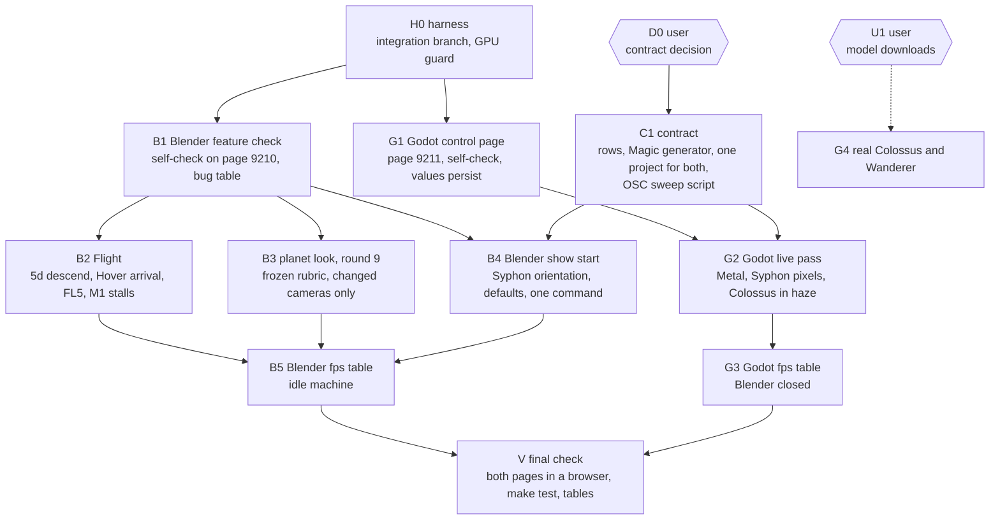

# Road to presentable: work graph (started 2026-11-10)

Goal: each scene (Blender Synthwave Planet, Godot Colossus) starts with one command, every exposed control works, proven by a self-check on the scene's own page, at a measured frame rate.

Orchestrator: the session on `integration/presentable` in the main checkout. It owns [STATE.md](../../STATE.md), this file, the merges and the GPU order. Sub sessions own one node each.

## Graph

## Nodes

| Node | Needs GPU | Model, effort | Branch | Done when |
|---|---|---|---|---|
| H0 | no | orchestrator | `integration/presentable` | `make blender-open` and `make godot-open` refuse each other |
| B1 | Blender | Sonnet 5.5, xhigh | `blender/feature-check` | page 9210 has a self-check, `make blender-check` prints one row per control, report lists every failing control |
| G1 | no (headless) | Sonnet 5.5, xhigh | `godot/control-page` | page 9211 serves controls and a self-check, `make godot-check` passes headless, values persist without packets |
| C1 | no | Sonnet 5.5, high | `osc/contract` | one meaning per address in `osc/CONTROLS.md`, generator and both scenes follow, one Magic project drives both |
| B2 | Blender | Opus 5.5, high | `blender/flight-fixes` | `make verify` passes, Hover arrives in 10 to 15 s, no cut stall above the M1 budget |
| B3 | Blender | Opus 5.5, high | `blender/look-round9` | every camera passes the round 9 rubric, verdict file from `shot-reviewer` |
| B4 | Blender | Sonnet 5.5, xhigh | `blender/feature-check` (B1 session continues) | one command from cold to a correct, upright Syphon frame with default values |
| G2 | Godot | Opus 5.5, high | `godot/live-pass` | self-check passes on Metal, `COLOSSUS_OUT` frame has content, Colossus readable in every director shot |
| B5, G3 | one each | Sonnet 5.5, high | `perf/fps-tables` | fps table per camera or shot with `fps_trustworthy` true |
| V | both, in turn | orchestrator | | both self-checks green in the browser, `make test` green |

## Rules of this run

- GPU order: one live app at a time. `make blender-open`, `make godot-open` and `make godot-capture` refuse while the other app runs. A refusal means: do GPU-free work, end the turn with a note. The orchestrator hands out the next live slot.
- Reviews stay cheap: numbers first (self-check table, ground check, cut timing), images only for cameras whose look changed, as contact sheets through `shot-reviewer`, one frozen rubric per round.
- Sub sessions do not edit `STATE.md` or this file. They write `docs/handover/<topic>.md` and commit on their own branch. The orchestrator merges into `integration/presentable`.
- B2 to B4 are cut from B1's table: a control that fails the self-check is a bug with an owner before any look work starts.

## Status 2026-11-10, after wave 1

Merged into `integration/presentable`: B1, G1, C1. On the merged branch: magic 44, osc 21, bridge 6, Godot 263 tests pass, `make godot-check` 22 of 22 headless, the Godot page's "Check all" gave 22 effect in a browser against a headless run on 19211.

What B1's table changed in the graph:

| Finding | Owner |
|---|---|
| `/vj/flight`, `/vj/boost`, `/vj/blend`, `/vj/hit`, `/vj/energy` do nothing: the runtime never starts `flight_rt` | B2 |
| `/vj/hue` ends in an unlinked node of `VJ_Color`; `/vj/grid_speed` has no reader | B4 |
| the `.blend` runs an embedded, stale copy of the runtime and bridge | B4 |
| island opens in Solid shading, its check is void | B4 |
| bridge scaling to 0..1 not yet observed in a live Blender | B4 |
| `/vj/nebula` shows on no camera | B3 |
| Godot ranges in `io/vj_map.gd` differ from `osc/contract.json` | G1 follow-up |

GPU order from here: B4 (Blender), G2 (Godot live), B2 live part (Blender), B3 (Blender), then the fps tables. B2 starts with its Blender-free part in parallel with B4.

## Status 2026-11-10, wave 2

Merged since: B4 and G2 (both on the wave 1 branches). Blender planet 33 of 37 controls with an effect, Godot 22 of 22 on Metal, Godot look round 1: 14 pass, 7 fail.

| Node | Worktree, branch | State |
|---|---|---|
| G5 Godot look round 2 (7 failing frames, Reset hitch, Shake from OSC) | `.claude/worktrees/godot-look-round2`, `godot/look-round2` | merged 2026-11-11: 19 of 21 frames pass, 2 open (Wanderer in the low hero shot) |
| B2 Flight and Energy | `.claude/worktrees/blender-flight`, `blender/flight` | session started 2026-11-11, Blender-free part first |
| B3 planet look round 9 | `.claude/worktrees/blender-look-round9`, `blender/look-round9` | session started 2026-11-11, Blender-free part first |

GPU order: G5, B2 live part, B3 live part, then the fps tables on an idle machine. B2 and B3 each begin with a Blender-free part.

## Status 2026-11-11, wave 3

The wave 2 sessions stopped at half context; fresh sessions continue from their notes on the same branches.

| Node | Branch | Note | State |
|---|---|---|---|
| B3 planet look round 9, live part | `blender/look-round9` | `docs/handover/planet-look-round9.md` | running, holds Blender |
| B2 Flight, Blender-free rest (`make verify` 3d and 7h, wiring, `PRECONDITIONS`) | `blender/flight` | `docs/handover/flight-presentable.md` | running, live part after the go |
| G6 Godot look round 3 (low hero keeps the Wanderer) | `godot/look-round2` | `docs/handover/godot-look-round2.md` | running, live part after Blender closes |

GPU order: B3 live, G6 live, B2 live, then fps tables.

Worktrees (user, 2026-11-11): fewer. The three wave 1 worktrees are removed. The three running sessions finish in theirs; each is removed after its merge. Later sessions work in the main checkout on `integration/presentable`, one writer per area.

## Status 2026-11-11, after round 9

- B3 merged: round 9, 26 of 35 shots pass. Its worktree is removed.
- New node B6, round 10: no dummy wireframe on the planet (user rule). Plan: `docs/handover/planet-look-round10.md`. Runs in the main checkout, fresh session, before the Flight live part.
- B2: Blender-free part done except two `make verify` checks; stays on `blender/flight` until it has run live.
- G6: live part running, holds the GPU.

GPU order: G6, B6, B2 live, then fps tables.

## Status 2026-11-11, after round 10

- B6 done in the main checkout: no dummy line source left on the planet, 17 of 19 shots pass.
- G6 merged: Godot look round 3, 357 tests, worktree removed.
- B7, round 11 (running): gentle relief on the flat ground so the real mesh edges read at night. Live part after B2.
- B2 live part running, holds Blender. Last worktree: `blender-flight`.
- G4 is active by the user's word: real models now, for early cost numbers. Waits for the downloads (pages in `godot/colossus/docs/SPEC.md`).

GPU order: B2 live, merge, B7 live, then G4 and the fps tables.

## Status 2026-11-11, after the Flight merge

- B2 merged: Flight works live, fixed shots show the planet as built, `/vj/cam` 0..11. No worktree is left; all sessions work in the main checkout.
- B7 done: relief on the plains (round 11), 14 of 19 shots pass; the lattice look of the night edges stays on smooth ground.
- B8 (running, holds Blender): round 12, irregular terrain mesh; also restores the CAM_0 flamingo flock.
- Open after B8: Hover arrival live (24.7 s), fps tables and cut stalls on an idle machine, G4 real models (waits for downloads), final check of both pages.

## Status 2026-11-11, Blender wrapped up

- V for Blender: planet page check 36 of 37 in a browser on a fresh open; start check green with the night-edge guard.
- V for Godot: page check 22 of 22 in a browser on Metal, OSC on the one scene port 9201, Syphon frame with content.
- The relay left the show path: Magic sends to udp 9201, both scenes listen there.
- Sessions are reused now; the last one (B9) carried the guard, the flamingo row, line motion, Hover arrival and the port change.
- Not done: B5 and G3 fps tables (the machine was never idle), G4 real models (downloads), the island's check rerun.

## Status 2026-11-11, Godot parked

- G4 done: real Wanderer and Colossus, cost under 0.5 ms over the stand-ins, look round 5 27 of 27.
- G5: look round 6 done, the frame-time table (G3) was stopped when the user parked the scene.
- README done and on `main`: screenshots, camera names, the manual of all OSC channels.
- Parked: everything Godot. To pick up: `docs/handover/godot-look-models.md`, `docs/handover/godot-models.md`.
- Still open for Blender: B5 fps table (idle machine), the island's check rerun.
