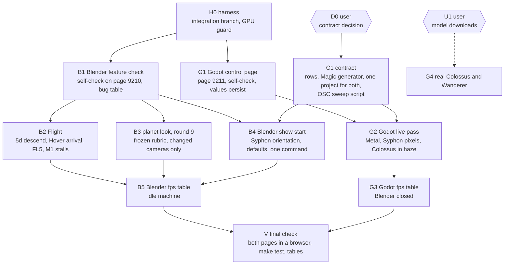

# Road to presentable: work graph (started 2026-11-10)

Goal: each scene (Blender Synthwave Planet, Godot Colossus) starts with one command, every exposed control works, proven by a self-check on the scene's own page, at a measured frame rate.

Orchestrator: the session on `integration/presentable` in the main checkout. It owns [STATE.md](../../STATE.md), this file, the merges and the GPU order. Sub sessions own one node each.

## Graph

## Nodes

| Node | Needs GPU | Model, effort | Branch | Done when |
|---|---|---|---|---|
| H0 | no | orchestrator | `integration/presentable` | `make blender-open` and `make godot-open` refuse each other |
| B1 | Blender | Sonnet 5.5, xhigh | `blender/feature-check` | page 9210 has a self-check, `make blender-check` prints one row per control, report lists every failing control |
| G1 | no (headless) | Sonnet 5.5, xhigh | `godot/control-page` | page 9211 serves controls and a self-check, `make godot-check` passes headless, values persist without packets |
| C1 | no | Sonnet 5.5, high | `osc/contract` | one meaning per address in `osc/CONTROLS.md`, generator and both scenes follow, one Magic project drives both |
| B2 | Blender | Opus 5.5, high | `blender/flight-fixes` | `make verify` passes, Hover arrives in 10 to 15 s, no cut stall above the M1 budget |
| B3 | Blender | Opus 5.5, high | `blender/look-round9` | every camera passes the round 9 rubric, verdict file from `shot-reviewer` |
| B4 | Blender | Sonnet 5.5, high | `blender/show-start` | one command from cold to a correct, upright Syphon frame with default values |
| G2 | Godot | Opus 5.5, high | `godot/live-pass` | self-check passes on Metal, `COLOSSUS_OUT` frame has content, Colossus readable in every director shot |
| B5, G3 | one each | Sonnet 5.5, high | `perf/fps-tables` | fps table per camera or shot with `fps_trustworthy` true |
| V | both, in turn | orchestrator | | both self-checks green in the browser, `make test` green |

## Rules of this run

- GPU order: one live app at a time. `make blender-open`, `make godot-open` and `make godot-capture` refuse while the other app runs. A refusal means: do GPU-free work, end the turn with a note. The orchestrator hands out the next live slot.
- Reviews stay cheap: numbers first (self-check table, ground check, cut timing), images only for cameras whose look changed, as contact sheets through `shot-reviewer`, one frozen rubric per round.
- Sub sessions do not edit `STATE.md` or this file. They write `docs/handover/<topic>.md` and commit on their own branch. The orchestrator merges into `integration/presentable`.
- B2 to B4 are cut from B1's table: a control that fails the self-check is a bug with an owner before any look work starts.
