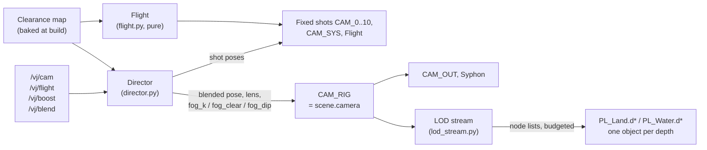
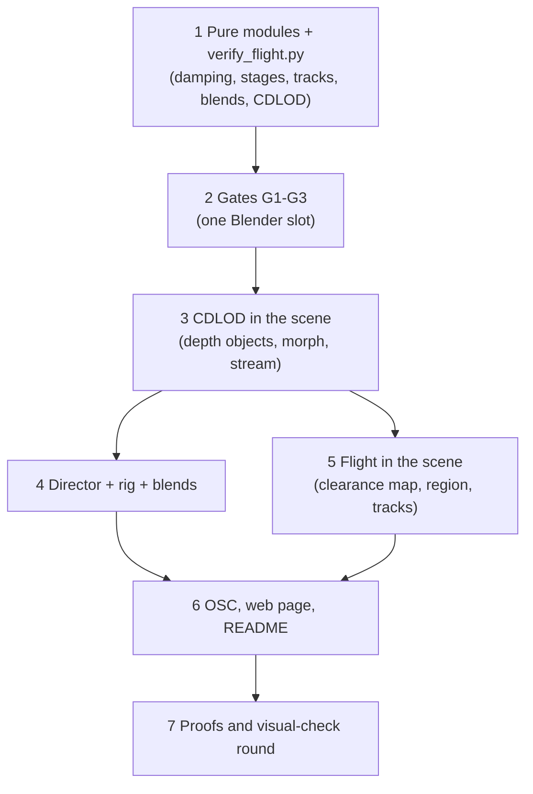

# Synthwave planet: the Flight camera, blended shots and continuous LOD

Plan for three linked pieces of the planet scene (`blender/scenes/synthwave_planet.blend`):

1. **Continuous LOD**: terrain and water detail follow a moving camera, with no pops or seams and no coarse patch near the camera.
2. **The Flight**: one procedural camera on `/vj/flight` 0..1 (Orbit, Approach, Skim, Hover), with `/vj/boost`.
3. **Blended shots**: every camera change, `/vj/cam` included, is an eased flight from the current view to the new shot, not a cut.

The terms are in [GLOSSARY.md](../../GLOSSARY.md) (Flight, Boost, On-Air Camera, Star System). The rules are in
[synthwave-visual-check.md](synthwave-visual-check.md) (FL1-FL5, G2, M1, S7).

Status: the pure modules are built and pass `verify_flight.py`. Gates G1-G3 pass, so the design holds; the scene integration is next.

## Scene integration (in progress, 2026-11-06)

All of this was measured under a load average of 160-200 (other processes), so treat the fps as relative only.

| Piece | File | State |
|---|---|---|
| Runtime | `scenes/flight_rt.py` | Started from the live scene through MCP; the hook in `synthwave_runtime.py` is not written yet.  - The rig CAM_RIG is the On-Air Camera, and a cut hands it back before the frame is drawn. - The Flight is shot CAM_11. - The clearance map is a 6 x 512² cube map, baked through `PL_Surface` in 2.2 s and cached in ~/Library/Caches. It finds 178 flight regions. |
| Flight | | The full descent works: 69 km at 0 s, 1.7 km at 24 s, 64 m skimming at 36 s, hovering at 54 s. The orbit frames the sun glare, the backlit moon and the Planet's night side. |
| LOD | `planet_proto/lod_scene.py` | A lean GN tree (`FLT_Lod`) evaluates `PL_Surface` once per vertex and draws land, its mirror copy and water. "Terrain LOD" and "Sea LOD" are copies of the planet materials with the morph as vector displacement.  - Blocks are baked: 8 GN builder objects evaluate 8 node lists in one depsgraph update (4 ms a block), and each evaluated mesh is copied into a plain mesh (`ID.copy`, 0.1 ms; `new_from_object` took 7 ms). Intermediate attributes are removed before the copy, and the river ribbons are baked once (`FLT_Rivers`), not converted in every block. - A timer bakes between frames, 6 ms a tick (60 ms while most of a selection is missing). A selection is shown all at once when its blocks are baked; blocks wholly past the horizon don't hold it up. - Only shown blocks are in the depsgraph. The rest of the cache (up to 2500, every fixed shot's prebuilt blocks among them) is out of it (`hide_viewport`). - Selection runs only after the rig has moved 8 m; a hard cut counts as no speed, and prewarming uses the margin at rest, so a cut finds its blocks. - A static view gives about 150 blocks. |
| Blends | | Work in the scene through the rig. Prewarming the target's blocks at the start of a blend is wired but not measured. |

Measured on 2026-11-06 after the LOD rework (load average 7-45, other processes; relative):
- **What made the frames slow:** 3400 prebuilt blocks kept in the depsgraph with only camera visibility off cost 26 ms of every depsgraph update (any geometry tag, about 8 µs per object) and 27 ms of every draw. Out of the depsgraph, a GN block re-evaluated when shown (3 ms each, 455 ms for a cut's 140 blocks), hence baking.
- **Fixed shots at rest:** about 10 fps before, 28-38 fps after (draw 21 ms, depsgraph update 3.5 ms).
- **Hard cuts to a prebuilt shot:** the first frame was 2-17 s; now three frames of 150-190 ms (showing about 140 meshes: 26 ms for depsgraph and visibility, the rest the first draw). M1 (70 ms) still fails. The first cut to CAM_SYS took 2.3 s (once 47 s, not reproduced).
- **Shots moving along a path:** CAM_10 (21 m/s) 9 to 31 fps, CAM_5 16 to 29 fps. CAM_4 (95 m/s) stays at 5-10 fps: it needs about 44 blocks a second and the queue never empties.
- **Block cost:** GN 5.9 ms for a 16-node block (rivers baked; 7 ms before). With `PL_Surface` alone at 0.3 µs a vertex (G1), most of it is the rest of the tree's per-evaluation overhead.
- **The Flight at sunset** (170 s: a cut to the Flight at the Orbit, `/vj/flight` 1, the energy to 1, a hit, a boost at the Hover, a hit, the energy to 0, back to 0; load average 5-10). Files in the shared notes folder, `flight-energy-proofs/flight_sunset/`.

| Stage | Frames | p50 ms (fps) | p95 ms | Worst ms |
|---|---|---|---|---|
| Orbit | 687 | 34.2 (29.2) | 135.7 | 425 |
| Approach | 387 | 101.1 (9.9) | 175.3 | 198 |
| Skim | 353 | 108.2 (9.2) | 176.2 | 188 |
| Hover | 779 | 35.5 (28.2) | 165.1 | 311 |

  - No still frame (EN1); never under the surface (FL3).
  - FL5 fails at the Approach and the Skim: about a third of the fixed shots' rate, the same block streaming limit as CAM_4.
  - FL2 fails at 8-12 km on the Approach, both ways: the frame-difference spikes at 20-23 s and 148 s are the globe handover, a night-side globe with lights switching to the sunlit planet with its land in one step (`spikes.png`). The others (35 s, 80 s, 124 s) are fast turns and the boost, not pops. The globe crossfade (G4) is the planet session's.

### Fast motion (FL5), second rework (2026-11-06, load average 60-150, so relative)

CAM_4 at 95 m/s went from 8 fps to 32 fps (p50 28 ms, p95 46 ms; fixed shots in the same session 29-35 fps, p50 28-30 ms). Each step, measured live, in order:

| Cost | Found | Change | Effect |
|---|---|---|---|
| `FLT_Lod` | A Store Named Attribute per `PL_Surface` output evaluated the surface again for each (256 nodes: height 12 ms, water +6, depth +16, flow +4) | One Capture Attribute with the three outputs | 86-99 ms to 30 ms for 256 nodes, identical output |
| Selection | `past_horizon` worked out the camera's part for every node | `lod_stream.horizon(cam)` once per selection | 5.4 to 2.4 ms, same leaves |
| Storing a block | `bpy.data.meshes.remove` scans every ID to unlink (2.7 ms) | `do_unlink=False` (no user left) | 3.9 to 0.17 ms a block; 8 to 14 fps |
| Showing blocks | Any `hide_viewport` change, or pointing an object at another mesh, rebuilds the planet's depsgraph relations: 15-20 ms per swap, for 1 block or 20. `hide_set` is cheap to toggle, but 2300 hidden objects in the depsgraph cost 6-7 ms of every update | Slots: about 200 objects that stay drawn, each mesh rewritten in place through the attribute API (`foreach_set` on `.edge_verts`, `.corner_vert`: microseconds; the old per-element API took 1.2 ms for edges alone). The cache holds arrays, not objects | 0.23 ms a block written; 14 to 22 fps |
| Block churn | The margin followed the Director's frame velocity (spikes to 3x) and the fps, so nodes near a split flipped | The selection step grows with the speed (a quarter of the travel) | Writes 61 to 17 ms/s; 27 fps |
| Baking | Only 13% of a changed block's nodes were new (351 of 2620) | Cache per node: builders bake new nodes only (a `nid` attribute marks each node's grid), numpy cuts them apart and assembles blocks (checked identical: positions, triangles, attribute sums). An LRU of 2000 assembled blocks | Bake 101 to 32 ms/s; 33 fps |
| Frame spikes | Selection, baking and a 20-block swap landing in one frame (51-64 ms) | `FRAME_MS` 8 ms of LOD work per drawn frame; a ready swap waits up to 3 frames for room; cuts and views at rest swap at once | |

### The look-ahead replaces the travel margin (5c fixed)

- The 5c pop: a depth-8 merge 478 m out, with a child vertex 675 m out, where the parent already morphs toward its own parent (its band starts at 662 m). The boost's margin took it 2 m over.
- The live margin (the travel until a selection is drawn) reached 160 m at 95 m/s. In the pure model, margins of 60 and 150 m give cracks of 0.8 and 3.5 m and pops of 0.9 and 4.9 m: the no-crack condition `K >= (2.83 + 2 * slack / size) / (2 * M0 - 1)` breaks at the fine depths.
- Morphing a child onto its parent's drawn (morphed) surface shrinks that, to 0.3 and 1.3 m, but uses the child's distance for the parent's factor, which gave 1.6 cm at 5c. Not kept.
- Kept: the design's look-ahead. Selection distances are to the segment from the camera to where it will be (`lod_stream.select(..., ahead)`): the travel, the selection step and the drawing lag go into its length, and the margin stays `SEL_STEP + 1` (as `prewarm()`, so a cut finds its blocks). Nodes on the way split early; behind and beside the camera the conditions hold.
- `verify_flight.py` section 5 models the same. 5c boost is 0.26 mm (was 12.9 mm); every check passes.
- The travel is the camera's own over the last half second, held at its peak with a 2 s time constant (a linear 20 m/s per s decay kept the descent's 8 km/s for minutes: an 8 km margin and a 130k-node selection at the Approach).

### Hard cuts (M1), staged

- With slots, a cut rewrites about 140 blocks. Measured on a warm cache: writing them takes 42 ms, the depsgraph 3 ms, and the first draw after it 92 ms (a normal draw 23-44 ms). So no single frame can hold it within 70 ms.
- Staged cut (`lod_scene.stage_tick`): a cut that changes more than `STAGE_MIN` (24) blocks writes them into spare slots whose matrix is zero, `STAGE_BLOCKS` (30) a frame, while the On-Air Camera keeps the old view (`flight_rt` places the rig only when `lod_scene.holding()` is false). Hidden slots are drawn, so their upload happens then; once the last ones have been drawn, one frame flips the matrices (2 ms of depsgraph). The old slots are emptied the frame after. `HOLD_MAX` (12 frames) forces the flip.
- Measured with 14 cuts through the fixed shots, blend 0, load average 16-30:

| Cuts | Worst frame per cut (ms) | View held before the cut shows |
|---|---|---|
| Second visit (blocks assembled before) | 67, 156, 65, 56, 71 | 4-6 frames, 210-300 ms |
| First visit after a start | 616, 329, 93, 78, 76, 169, 168, 72, 846 | 4-12 frames, 220-1950 ms |
| Before staging, second visit | 117-223 | none |

- M1 holds on most second visits, not on first visits. A first use of a slot costs 300-600 ms of draw for 30 blocks, against 10-20 ms once a slot has been drawn. Probably the draw cache or the shader setup for a new object; not measured further.
- The cost of staging: a cut shows 4-6 frames (about 0.2-0.3 s) after the OSC value arrives. M2 still holds, since the first frame of the new shot has its own aim.
- Options left:
  - Warm every slot at start: write a block into each of the 200 slots once, hidden.
  - Keep the fixed shots' assembled blocks pinned outside the LRU, so a first visit needs no assembly.
  - Lower `STAGE_BLOCKS` for a smoother hold at the cost of a longer one.

### Proof runs (2026-11-06, the planet build 981f646, load average 16-60)

Files in the shared notes folder, `flight-proofs/` (trace, sheet, video and summary per run). Each sweep: the fixed shots CAM_0, CAM_2 and CAM_9 for 12 s each (the baseline), a cut to the Flight at the Orbit, `/vj/flight` 1, back to 0 after 80 s. `fl5_report.py` splits the frames by shot and stage.

- **With 15 Hz grabs** (day, sunset with two boosts and a hit at the Hover, night): every segment runs at 8.5-9.9 fps, the fixed shots too. The grabs dominate, so these runs prove FL2-FL4 by frames and not FL5.
- **FL5, sunset without grabs** (`fps_sunset`, one grab every 2 s for the stage):

| Segment | p50 ms (fps) | p95 ms | FL5 (p50 within 10%, p95 within 20% of the fixed mean) |
|---|---|---|---|
| Fixed mean (CAM_0, CAM_2, CAM_9) | 34.9 | 58.6 | |
| Orbit | 30.5 (32.8) | 37.3 | pass |
| Approach | 35.3 (28.3) | 105.3 | fail on p95 |
| Skim | 40.3 (24.8) | 95.6 | fail (p50 15% over) |
| Hover, with the boosts | 33.2 (30.1) | 68.6 | pass |

  The first sunset run (before this rework) had the Approach and the Skim at 9-10 fps against 28-29 at the Orbit.
- **FL2:** the frame-difference spikes outside the programmed cuts are at the day sweep's Hover (104 s and 108 s, 300 m over a lake) and the sunset Hover (110 s). The day frames show a hillside filling the frame with large flat triangles that change shape within 0.2 s: coarse blocks near the camera and a swap. Not explained yet. The same frames fail FL4 (one hillside over 60% of the frame). No spikes at the Approach's globe handover (8-12 km) in any of the three sweeps, so the planet session's handover dissolve holds.
- **EN1:** 12 still frames per sweep, all in the staged cuts' holds (the rig was not placed while held). Fixed after the runs: the old shot keeps moving during a hold (`flight_rt.frame`), not yet run live.
- **EN5** (CAM_2, energy 1, 40 pulses at 124 BPM): the lens pushes at most 1.2% (limit 2%), the largest turn in a frame is 0.8° (with the energy's ellipse), no still frame.
- **Blends** (`blends`): CAM_0 to CAM_2, to CAM_9 with a change of mind to CAM_0 after 3 s, CAM_3, the Flight, CAM_6: no still frame; one spike at 21 s (the blend into CAM_2's arrival) and one at 144 s at 64 km (the CAM_6 orbit).
- **CAM_4 at day** with the runtime: smooth-shaded, a few flat facets on far ridges, and no wireframe. Expected: since 981f646 the wires draw only where the normal is within about 14° of up and the view distance under 3.5 km, and they read `pl_w` and `mirror`, which the blocks carry. From CAM_4's 650 m over steep ridges they are faint by design.

Open:
- FL5: the Skim's p50 and the Approach's and the Skim's p95.
- FL2: the coarse blocks at the Hover (above).
- FL2 at the globe handover: no spike in the three sweeps since 45b3cc5 and 08d52c1.
- The three sweeps each began a new Orbit visit, so each flew a new seed; the seeds were not logged. The recorder should log `Flight.seed`.
- Proofs again on an idle machine: these ran at load average 16-60 with other heavy processes.
- M1 on hard cuts: staged (above); first visits still fail.
- Write the `synthwave_runtime.py` hook (load `flight_rt` like `star_system`) and the planet session's hooks: drop `lod_sets()` and skip `update_lod` for the rig.
- Props and flamingo flocks still come from the nearest old set.
- Done by the planet session in 8a31dd7 (merged here as 1ef1bcf): the `star_system` `up` blend over rt_space, and aiming every `vj_track` camera each frame (`verify_star_system.py` 14j-l).
- `star_system.py` 8a31dd7 (merged here) aims every `vj_track` camera; the live runs above still used the planet worktree's copy loaded by the .blend.

### Round 2 (2026-11-06, planet build 2bbbb56, load average 25-40)

**FL2 at the day Hover: found and fixed (2a680ef).** The "coarse flat blocks" were the finest blocks (6 m cells) seen from 4 m. The Hover drifted at 6 m/s toward a water loop 1.1-1.7 km away, 4 m over dry hillsides. In all three round 1 sweeps the clearance map shows it on dry ground (day 296 m, sunset 216 m, night 67 m), 1.8-2.9 km from its loop.

| Change | Why |
|---|---|
| Up to 4 water loops per region (`HOVER_LOOPS`), at least 1.5 km apart, nearest the Skim ring first | one loop could lie 4-6 km from where the camera is when the Hover is asked for |
| Past the Skim's key the camera steers for the loop nearest it (full at f 0.75, `HOVER_STEER`) | the transit happens in the Skim-to-Hover blend, not inside the Hover |
| The stage in effect (`Flight.fe`) stays the Skim (85 m/s, 45 m, 20 mm) until the camera is within 400 m of the loop, then eases into the Hover by distance | the Hover only drifts (6 m/s), only over water |
| A speed floor brakes onto the loop at 8 m/s² (`HOVER_DECEL`), rate-limited and not rising during a boost | a jump to 6 m/s, and a boost feeding back into its own speed, failed 3f |
| Once on its loop the Hover holds until 700 m off it (`HOVER_RELEASE`). A boost that carries the camera off the loop lifts it toward 45 m over 600 m | the 0.4 g turn can't follow a loop at boost speed |
| The stage height is followed with the 0.8 s spring | holding the Skim stopped its descent curve dead (3f spike at f 2/3) |

- Pure checks: `verify_flight.py --quick` passes. New checks:
  - 3h: the Hover is in effect within 9.7 s of f reaching 1 at the region (limit 15).
  - 3i: once on its loop without a boost, the camera stays within 40 m of it (limit 80).
  - 3f is 36.9, as before.
- Live clearance map, 8 seeds, f 0 to 1:
  - The Hover is in effect 0, 3.8, 10.5, 10.7, 11.6, 14.1, 25.8 and 28.3 s after f reaches 1.
  - Never over dry ground.
  - It takes effect about 67 m off the loop at 22 m/s or less, then drifts at 6 m/s.
  - The two slow seeds have all their water on one side of the region; more loops (6, 8) don't help.
- Cost: the region lock (Skim and up to 4 water loops) takes 160-240 ms in one frame at the Orbit, up from about 90 ms. Option: plan the water loops over several frames, or when f passes the Approach.

**CAM_4 pale wedges and crease (round 5 grabs): not in the LOD blocks.** With `flight_rt` running, CAM_4 at loop 0 by day and at sunset shows no wedge at the water's edge and no crease at x~690. The water meets the shore cleanly and the wires draw on the hill. The wedges belong to the planet's patch sets, which the runtime hides. Grabs: notes folder, `flight-proofs-r2/cam4/`.

**EN1 holds: pass.** 8 hard cuts at blend 0 (`flight-proofs-r2/en1_cuts`): every staged hold (6-7 frames) moves. The only still frames (5) are the first hold right after `flight_rt.start()`, when there is no old shot to keep moving.

**M1, measured again (same run and a second pass, warm cache):**

| Cut | Worst frame (ms) |
|---|---|
| First pass: CAM_0 (start), 2, 9, 7, 3, 0, 8, 2 | 234, 99, 138, 84, 78, 64, 297, 111 |
| Second pass: 0, 2, 9, 7, 3, 0, 8, 2, 10, 1, 0 | 352, 152, 120, 312, 82, 67, 306, 72, 311, 119, 68 |

- The holds take 6-7 frames, 270-990 ms. Normal frames are 25-32 ms.
- Where the slow frames go:
  - Writing 30 blocks costs 15-40 ms, with spikes of 168-251 ms.
  - A first cut to CAM_10, a path shot that is never prewarmed, spent 220 ms in selection (`make_hr` for new nodes).
  - Some frames with no LOD work take 200-220 ms: the first draw of newly written slots.
- Writing into a fresh slot costs about 6x a rewrite (56 against 6-9 ms for 30 blocks).
- M1 still fails. Options, in order of likely effect:
  - warm every slot once at start (a block written and drawn hidden);
  - prewarm the path shots at their current pose;
  - write by time, not count (`STAGE_BLOCKS` 30 to an 8 ms budget);
  - keep each fixed shot's blocks resident in slots (a cut becomes a matrix flip), at a draw cost per resident slot that is not measured yet.

**Proof runs, round 2** (planet build a179c28, merged; load average 18-30; notes folder `flight-proofs-r2/`). The sweeps flew seeds 62887 (day), 62888 (sunset) and 62889 (night), so three seeds are covered; `fps_sunset` flew 62890. Also EN5 and the blends.

- **EN1:** no still frame in any run.
- **FL5** (`fps_sunset`, no grabs; fixed mean p50 32.0, p95 39.7 ms):

| Segment | p50 ms (fps) | p95 ms | FL5 |
|---|---|---|---|
| Orbit | 25.7 (39.0) | 38.8 | pass |
| Approach | 36.6 (27.3) | 112.4 | fail (p95) |
| Skim, including the transit to the water | 40.8 (24.5) | 83.8 | fail (p50 +27%) |

  Not profiled this round. The suspects:
  - Approach: the `CUT_MS` 60 ms bake budget, used while over half the wanted nodes are missing.
  - Skim: `FRAME_MS`, 8 ms of LOD work per frame.
- **The Hover live:**

| Run | Result |
|---|---|
| Night | 6 m/s at 4 m within about 5 s of f reaching 1 |
| Sunset | in effect with the boosts, 8-14 m |
| Day, `fps_sunset` | never in effect within the 80 s hold: the camera stayed in the Skim transit at 85 m/s |
| Live check afterwards | in effect 30 s after f reached 1, from 2 km; latched at 6 m/s |

  The transit is slower live than in the pure runs. At f 0.70-0.93 the blended steering closes only 40-57 m/s of the 85 m/s. The 10-15 s target is not met live.
  - Options: steer for the water fully from the Skim's key; a faster transit (toward the boost's 155 m/s); regions whose Skim ring has water within 1 km.
- **New finding, FL4/G6 (planet look):** at 4-45 m over water, the water is a flat dark slab with no reflection. This shows at the sunset Hover and on the day transit; the night Hover frame is almost black.
  - All of these frames are over the sea (water level 0 m, ground 14-84 m below it), 22-27 km from the island pole, not over high lakes.
  - Frames: `sweep_night/f00903.ppm` and `f00954.ppm`, `sweep_sunset/f00933.ppm`, `sweep_day/f00848.ppm` and `f01150.ppm`. Positions are in each run's `trace.json`.
  - Raised with the planet session.
- **FL2:** no frame-difference spike at the Hover. Day spikes at 137-139 s are the Skim at 20-26 m beside a slope.

## Gate results (live synthwave_planet.blend, 2026-11-05, M1 Max, load average about 200)

The machine was heavily loaded, so the absolute times are high. The ratios are what decided the design.

| Gate | Measured | Verdict |
|---|---|---|
| G1 | A probe object evaluating `PL_Surface` alone: 10 vertices 1.3 ms, 1k 2.0 ms, 10k 7.8 ms, 100k 32.6 ms. So about 0.3 µs per vertex plus about 1.3 ms fixed; the Hydro inputs add no large fixed cost. Re-evaluating today's land set `Planet.CAM_0.0` (216k vertices) takes about 2 s, and the water set about 3.2 s. Their time barely changes with vertex count (127k vertices: 2.0 s), so it goes into the rest of today's patch graph (stitching, mirror copy, the 8 instance levels over 6144 patches), not into the surface. | Pass. A block object (16 nodes x 81 vertices) with a lean graph costs about 1.7 ms here. That is about 2 ms a frame while skimming and about 4 ms while boosting, within the 4 ms budget. |
| G2 | A test grid with `displacement_method` DISPLACEMENT: the silhouette is displaced and normal-coloured bands follow the displaced surface. | Pass: EEVEE moves the vertices and recomputes the normals. |
| G3 | Rewriting the probe's base mesh re-evaluated only the probe (1.5-1.8 ms); no land set re-evaluated (that would have cost 2 s). | Pass. |

## Results so far (pure models, `verify_flight.py --quick`, all checks pass)

| Piece | File | Outcome |
|---|---|---|
| Flight | `scenes/flight.py` | 3 seeds x 6 control programs (sweeps, steps, random jumps every 5 s, ramps, boost bursts, dither). Results: the floor never binds; the view turns at 43°/s or less; acceleration under 2 km stays at 4 g per 150 m of height or less; the horizon stays in frame below orbit; the Planet and moon fit at orbit. |
| LOD | `scenes/planet_proto/lod_stream.py` | `N` 8, `K` 9, `M0` 0.75. Skim, boost (155 m/s), descent (3 km to 50 m) and hover, all with 3 frames of selection lag: no cracks or pops over 1 cm in view, at most one depth step across an edge, and no node coarser than asked within 2.5 km. Load: about 110 k vertices; 80 block changes/s and 52 k vertices re-evaluated/s while skimming (150/s and 97 k with boost); 10/s and 6 k while hovering. |
| Blends | `scenes/director.py` | Velocity and acceleration carry over, with no step on a change of mind mid-blend. On the target at the end; clear of the terrain; the view turns at 27°/s or less. |

What the checks changed in the design:
- **Control:** an acceleration-limited follower (`glide`) instead of SmoothDamp, whose acceleration jumps with its target. A jump from 0 to 1 takes about 53 s.
- **Altitude:**
  - It follows a monotone cubic in log space, so the descent rate is even across stages.
  - It is the followed terrain envelope plus A(f): the follower lags only the terrain, never the control.
  - The envelope is a cone hull (CLIMB 0.35 m per m), so a peak entering the look-ahead raises the goal gradually.
- **LOD bounds:** use each node's own height range (its parent's grid, padded). The planet-wide range (about 450 m on a 49 m node) put a coarse neighbour's morph band on a fine edge.
  - The no-crack condition is `K >= (2.83 + 2 * slack / size) / (2 * M0 - 1)`.
- **Horizon cull:** splits and merges caused by it happen past the horizon, where they can't be seen.
- **Blend phases:** three overlapping phases. The clearance rises on a log curve over the first 40%, the ground point traverses over the middle 50% while high, and the clearance descends over the last 40%.
  - The duration keeps the ground flow and the rise under 1 rad/s and the view turn under 40°/s.
  - That makes blends long at `/vj/blend` 1: 20 s for 2-5 km, 36 s from the ground to orbit. `/vj/blend` scales them.
- **Selection is too slow in pure Python:** 9.8 ms per frame on this machine under load, against a 0.5 ms budget. The runtime needs incremental re-selection: re-test only the nodes whose distance slack the camera has used up.

## Why the current scene can't do this

- **LOD by sets.** `build_planet.py` evaluates a land, water and props set per camera at load (`lod_sets()`). `planet_runtime.py` switches sets only on cuts, and flights take the nearest of 3 sets along their path.
- **Moving the anchor costs a lot.** One `LOD_Anchor` drives all 6144 patches of land and water. Moving it re-evaluates the whole planet: 155 ms a frame, 6.7 fps in `planet-fps-baseline.md` ("follow" mode).
- **Hard level switches.** A patch takes one level from 0 to 7 for all of its 785 m. A level change swaps the whole patch at once, and stitching moves its border vertices. That is the grid and wire jump at patch borders the user saw.
- **Anchor-relative extras.** River water (`RIVER_REACH`), the mirror copy (`MIRROR_REACH`), palm clearing (`PALM_CLEAR`), props (`Props Distance`) and flamingo flocks are all measured from the anchor. They would pop whenever the anchor moves.
- **Sky "up" jumps.** `star_system.solve` uses `up = POLE_UP if space > 0 else radial`. A camera descending through 2 km would see the sun jump.
- **Globe handover is a hard switch.** The globe takes over from the patches at `eye_space` 0.7 (about 9 km, `GLOBE_FROM`) through `LESS_THAN` and `GREATER_THAN`. The Approach flies through it.
- **Instant cuts.** `/vj/cam` sets `scene.camera` in the OSC bridge. CAM_OUT copies it.

## Architecture

- **One On-Air rig.** `CAM_RIG` is always `scene.camera`. A shot is a pose source, never the scene camera. The rig carries the blended per-shot properties (`fog_k`, `fog_clear`, `fog_dip`, `lod`), so `planet_runtime.planet_tick` and the fog keep reading `scene.camera` unchanged.
- **Shots.** Fixed cameras stay as built: drivers, constraints, `vj_track`, `pl_sun_rel`. Their evaluated `matrix_world` and lens are read every frame. The Flight is one more shot, `CAM_FLIGHT`, and becomes a `/vj/cam` number (the next free CAM_N).
- **Pure math in plain Python.** `flight.py`, `director.py` (blend math) and `lod_stream.py` (node selection and morph ranges) import nothing from `bpy`. They are tested by `verify_flight.py` without Blender, as `verify_star_system.py` is. Thin adapters in the runtime read and write Blender.

### File ownership (proposed to the planet session, to be confirmed)

| File | Owner | Change |
|---|---|---|
| `scenes/flight.py`, `scenes/director.py`, `scenes/planet_proto/lod_stream.py`, `docs/research/synthwave-flight/verify_flight.py`, this doc | flight session | new |
| `scenes/synthwave_runtime.py`, `scenes/synthwave_web.py`, `README.md` address table | flight session | new values, director hook |
| `blender_osc_bridge.py` | flight session | `/vj/cam` leaves `scene.camera` alone when the scene has a rig |
| `scenes/star_system.py` | star system owner (coordinator) | smooth `up` between radial and `POLE_UP`, and aim each `vj_track` shot rather than only `scene.camera` |
| `planet_proto/build_planet.py` | planet session | one hook each: the depth objects with the morph attribute, the clearance-map bake, the globe crossfade |
| `planet_proto/planet_runtime.py` | planet session | `update_lod` delegates to `lod_stream` for the rig |

## Continuous LOD (CDLOD on the cube sphere)

Chunked LOD after Strugar's CDLOD: a quadtree selected by screen error, each node one fixed grid, and vertices
morphing toward the parent lattice before a node merges. A node set only changes where the morph has already made it look like the coarser one.

### Nodes

- **The quadtree.** Each of the 6 cube faces is a quadtree root. A node at depth `d` spans `25.1 km / 2^d`: depth 5 is today's 785 m patch, depth 8 is 98 m.
- **One grid for every node.** Every node is the same `N x N` grid, with `N = 16` *(gate)*, so a depth-8 cell is 6.1 m, as at today's level 7. There is only one instance grid; today there is one per level.
- **Directions as now.** A vertex's direction is today's `cube_dir(face, face_uv(...))`. Its height comes from today's `PL_Surface` group, unchanged.

### Selection by screen error (Python, each frame, numpy)

- **Split rule.** A node splits while `dist(camera, node bounds) < K * size_d`. Bounds include `H_MAX` of relief.
- **K from screen error.** `K = N * k_px` with `k_px = (H_px / 2) / tan(fov_v / 2) / tau`, where `tau` is the allowed cell size in pixels. Lens, render height and boost FOV then all move the split distance the same way.
  - At today's look (`Detail` 0.03 rad per cell), `tau` is about 40 px at 960x540 and 50 mm.
  - It stays one knob, `Detail`, as now.
- **Restricted quadtree.** Neighbours differ by at most one depth. Splits are forced where the rule alone would break this.
- **Horizon cull as now.** Nodes past the horizon stay at depth 1, so a free zoomed-out view still sees a whole sphere.
- **Look-ahead.** Selection runs for the camera position `t_ahead = 0.5 s` ahead (velocity known) and for the current one, and keeps the finer node of the two. Fine detail is ready before the camera gets there.

### Morph (vertex shader, every frame, no geometry work)

- **The morph target.** Each vertex stores its parent-lattice position as `pl_morph`: the offset to the midpoint of its even neighbours along each odd axis, using the same sampling `stitch()` does now.
- **The blend.** The material's displacement output applies `m * pl_morph`, where `m = smoothstep(r0_d, r1_d, |P - cam|)` and `[r0_d, r1_d] = [0.7, 0.95] * K * size_d`.
  - Each node stores `r0_d` and `r1_d` as attributes.
  - The camera position comes from `rt_cam_*`, already written each frame.
- **No pop at a merge.** A node is fully morphed (`m = 1`) wherever it can merge, so its mesh is exactly the parent's there and a merge changes no pixel. A split is the same in reverse.
- **Seams.** Edges that touch a coarser neighbour are stitched as now. Their morph is fixed at 1, so both sides draw one polyline.
- **The morphed copies.** The water, the land's mirror copy and `pl_w` / `pl_depth` use the same morph, so shores move with the land.
- **Gate.** EEVEE vertex displacement with smooth normals must work on Terrain and Sea *(gate G2)*. If it doesn't, the fallback morphs in GN at re-evaluation time, using the selection camera position, with a band twice as wide. That hides the steps but is not exact.

### Incremental updates

- **One object per depth and type.** `PL_Land.d0..d8` and `PL_Water.d0..d8`, 18 objects. Each object's base mesh is its node list: one point per node, with face, origin, size, depth, edge neighbour depths and morph ranges.
- **Writes only on change.** Python writes a depth's node list (`foreach_set`) only when that list changed. Only that object re-evaluates.
- **The anchor goes.** No object reads a shared anchor any more, so moving the camera re-evaluates nothing by itself.
- **Change rate.** At speed `v`, depth `d` changes about every `size_d / v`. Skimming at 85 m/s: d8 every 1.2 s, d7 every 2.3 s, d6 every 4.6 s. Hovering at 6 m/s: d8 every 16 s.
- **Budget.** At most one depth object re-evaluates per frame, with the finest due first *(gate G1: target 4 ms or less for a depth object)*. The look-ahead margin hides the lag.
- **Hard cuts.** At `/vj/blend` 0 the whole selection is written in one frame, as today's cut, held to M1's 70 ms or less.
- **Fixed cameras.** The node lists don't change, so nothing re-evaluates. The per-frame cost is the numpy selection (0.3 ms or less) and the morph in the vertex shader. They stay as fast as now; FL5 checks it.

### Extras that read the anchor today

| Today | Continuous |
|---|---|
| River water within `RIVER_REACH` of the anchor | River water by node depth (cells of 25 m or less). The water shader fades river surfaces out between 1.3 and 1.8 km from the camera (per pixel, live), so a depth change past that distance is invisible. |
| Mirror copy within `MIRROR_REACH` | Mirror nodes for depths whose range is under 1.8 km, faded by camera distance in the shader, as above. |
| Props within `Props Distance`, palm clearing at the anchor | Props on the fixed icosphere, as now, selected per region chunk and faded in by distance in the shader. Palm clearing goes away (shots don't need it once nothing sits on the camera). |
| Flamingo flocks baked per set | One flock per pyramid group, baked once. The runtime shows the flock nearest the camera. |
| Globe at `eye_space` 0.7, hard switch | A dithered crossfade over `eye_space` 0.6 to 0.8 (planet session). The Approach checks it in the frame-difference trace. |

## The Flight

### The control

- **Damping.** `f` is `vj_flight` damped by a critically damped spring (SmoothDamp, time 2.5 s, speed at most 0.05/s). A jump from 0 to 1 takes about 25 s and flies through every stage.
- **Boost.** `b` is `vj_boost` damped with a 0.35 s attack and 1.5 s release.
- **A seed per orbit visit.** Each time `f` falls back under 0.02, a new seed is drawn. The region and the stage tracks are re-planned while the camera is far out, where nothing near it changes.

### Stages as a continuum

Every value of `f` is a valid shot, not only the four keys. Stage parameters are keyed at `f` 0, 1/3, 2/3 and 1 and
interpolated with smootherstep weights `w_k(f)`. Altitude and lens are interpolated in log space, angles on the circle.

| Param | Orbit 0 | Approach 1/3 | Skim 2/3 | Hover 1 |
|---|---|---|---|---|
| altitude over the clearance envelope | 69 km (85 km from the centre, outside the moon's 38.5-61.5 km shell) | 3 km | 45 m | 4 m over water |
| speed | orbit phase 2π / 240 s | 150 m/s | 85 m/s | 6 m/s drift (+70 m/s at full boost) |
| lens | fitted to the frame (below), 18-50 mm | 28 mm | 20 mm | 24 mm (14 mm at full boost) |
| pitch | aim at the system | -18° toward the landing region | -6° ahead | -2° (horizon in frame) |
| bank | 0 | 12° into the holding turn | from turn rate, up to 35° | from turn rate, up to 10°, plus a slow 1.5° sway |
| lateral acceleration limit | none | 0.3 g | 1.5 g | 0.4 g |

### The region

- **Chosen from the height data.** The clearance map gives the candidates: spots where 250 m or more of relief within 2 km meets water (sea coast, a lake, or a river at least 1 km long), at least 300 m from pyramid groups.
- **Chosen near the orbit.** When `f` leaves the Orbit, the seed picks among the candidates within 60° ahead of the orbit's ground point. The descent then always de-orbits forward and never swings across the Planet.
- **Tracks.** Built in numpy on the clearance map when the region locks (a few ms):
  - **Approach:** a holding circle of 4 km radius around the region centre, shrinking toward the Skim track as `f` grows.
  - **Skim:** a closed loop of about 1.8 km radius around the region's mountains. For each angle, it takes the lowest point within ±400 m across the loop (passes and saddles). Then it is smoothed as a periodic spline with limited curvature.
  - **Hover:** a closed loop over water, 60 m or more from any shore (a distance transform on the water mask), the one nearest the Skim loop. On a river, it follows the river centreline from the Hydro curves, with a slow yaw turn at the ends.

### Motion (integrated each frame, 1/120 s substeps)

- **Ground point and heading.** The ground point `u` (unit direction from the planet centre) moves along a heading at speed `V(f, b)`.
- **Steering.** The heading steers by pure pursuit toward the blended target: on each stage's track, the point `L = 2 s * V` ahead of the projection, combined across stages with `w_k(f)`. Turn rate is limited by the lateral acceleration limit.
  - The position therefore can't jump, and turns are bounded: FL1 holds by construction.
- **Altitude (FL3).** `alt = env(u ahead) + A(f)`.
  - `env` is a smooth max of the clearance map over the next `max(2 s, 300 m)` of track, so the camera climbs before a ridge, not at it.
  - Altitude then goes through a follower that climbs faster than it sinks.
  - A hard floor `ground(u) + h_min(f)` is the guard: 25 m when skimming, 2.5 m over water. Any frame where the floor binds is counted.
- **Orbit framing.**
  - **Aim:** at the angular-size-weighted mean direction of the Planet and moon.
  - **Lens:** fitted so both bounding spheres fit with 10% margin. When they can't both fit, the Planet wins.
  - **Orbit plane:** tilted ±25° (by seed) from the plane holding the sun direction. The camera then passes behind the Planet for limb sunrises and eclipse alignments.
  - **Moon:** a soft repulsion keeps the camera at least 5 km off the moon's surface, which matters when it crosses the shell.
- **Look-ahead framing.** The view looks at the point `tau_look = 1.2 s` ahead on its own path, blended with the stage subject: the region centre on the Approach, the horizon when hovering. Orientation goes through a critically damped quaternion follower (0.25 s).
- **Boost.** Speed rises by `b * 70 m/s` (weighted by the Hover and Skim weights), the lens widens toward 14 mm and pitch drops 3°. `rt_shake` adds a light shake. Look-ahead grows with speed.
- **Energy and hits.** The eased energy (below, "Energy controls") scales the stage speed (0.75x at none, 1.4x at full), adds up to half the boost while hovering, and lowers the Skim and Hover height by up to 20%. It goes through the Flight's own acceleration-limited follower, and the height term is squared, so the climb rate has no kink. A hit is a short boost (its kick doubled, through the boost's follower with a softer 0.8 s attack), and a swoop of up to 1.5x the speed at Orbit and Approach.
- **Pulse.** The Director puts the pulse on every shot, the Flight included (below).

### The clearance map (baked at build)

- **What it is.** A cube map of 6 x 768² cells (about 33 m) from `PL_Surface`, probed once at build time *(about 3.5 M samples, gate G1)*.
- **Ground.** Stored as a conservative max: the 3x3 neighbourhood max of the samples plus a slope margin. Pyramid volumes and palm heights are added. Bilinear lookups never fall under the true ground.
- **Water level.** Stored next to it.
- **Where it lives.** A float image with a fake user. The runtime reads it into numpy once.
- **Who uses it.** The Flight and blend paths anywhere on the Planet use it, and so do the verify checks (a synthetic planet in tests).

## Blended shots (the Director)

- **The trigger.** `/vj/cam` picks the target shot. The rig flies from its current pose and velocity, which can be mid-blend, to the target shot's live pose, which can be moving.
- **Duration.** `D = vj_blend * clamp(2 s + 1.2 s * log2(1 + d / 200 m) + 1.5 s * angle / pi, 2, 14 s)`, where `d` is the ground distance and `angle` the change of view direction.
  - `vj_blend` 0 is a hard cut, as today.
  - `vj_blend` 1 is the default.
- **Ease.** Quintic, C2 at both ends. The start matches the rig's current velocity (Hermite tangent), so changing your mind mid-blend never kinks.
- **Path.** In planet-centric coordinates: the ground point by slerp, altitude by lerp plus a hump `H = clamp(0.25 * d, 0, 30 km) * 4s(1 - s)`.
  - Short changes become dolly and crane moves.
  - Across the Planet, the camera pulls out toward space and comes back down (the round-5 pull-out proof shows it holds up).
  - A long hop that rises keeps the ground's angular speed low, which also keeps the LOD stream light.
- **Clearance.** The clearance map floor along the path, and the same guard as the Flight.
- **Orientation.**
  - The forward vector slerps from A to B. On a long hop it bends toward the travel direction mid-way: look where you go, weighted by `4s(1 - s) * min(1, d / 2 km)`.
  - Roll lerps.
  - Up is the radial up, so the horizon stays level.
- **Lens.** Log-lerp, widened by up to 30% mid-way on long hops.
- **Shot properties.** `fog_k`, `fog_clear` and `fog_dip` lerp. `vj_track` shots keep their live aim, which star_system must compute for any tracking shot.
- **The Flight as a shot.** Blending into the Flight targets its live pose. While a blend into the Flight runs, the Flight's integrator is advanced as normal.
  - Blending out of the Flight freezes its integrator at the blend start, so the next return continues where it left off.
- **Dynamics on every shot.**
  - `rt_shake` as now.
  - The energy move, the hit's kick and the pulse ("Energy controls").

## OSC values

| Address | Range | Default | Meaning |
|---|---|---|---|
| `/vj/flight` | 0..1 | 0 | Flight stage: 0 Orbit, 0.33 Approach, 0.66 Skim, 1 Hover. Damped: a jump flies. |
| `/vj/boost` | 0..1 | 0 | Accelerator while skimming or hovering. |
| `/vj/blend` | 0..2 | 1 | Duration scale for shot changes. 0 is a hard cut. |
| `/vj/cam` | 0..N | 0 | As now, plus `CAM_FLIGHT`'s number. It now starts a blend. |
| `/vj/energy` | 0..1 | 0.3 | How hard every camera moves ("Energy controls"). |
| `/vj/hit` | trigger | 0 | Rising edge over 0.5: a speed surge and a wide-angle kick. |

They are added to `DEFAULTS` and `RANGES` in `synthwave_runtime.py`. The web page builds its sliders from those, and the README address table gets the new rows.

## Energy controls (approved, built; rules EN1-EN5 in the visual check)

The scene knows nothing about music. Blender reads only OSC values and its own clocks: no audio files, no FFT, no onset or tempo detection, and nothing derived from trends in `vj_level` or `vj_bass`. Magic Music Visuals turns the music into these controls. Easing an incoming value is allowed; analysis is not.

| Address | Range | Default | Kind | Effect |
|---|---|---|---|---|
| `/vj/energy` | 0..1 | 0.3 | continuous, eased (95% of a step after 1.5 s up, 4 s down; two first-order stages, so a step starts without a jolt) | How hard every camera moves. Low: a slow, wide floating glide. High: faster and tighter, pushed in, with bigger pulse accents. At the default, which applies while nothing has arrived, every shot still moves (EN1). |
| `/vj/hit` | 0..1 | 0 | trigger, fires on a rising edge over 0.5 (like `/vj/shock`; a button on the web page) | A surge of speed with a wide-angle kick (lens down to 0.7x within a few frames, back over 2 s), and a swoop along the path on shots that orbit or fly. Starts on the frame it arrives (EN3). |
| `/vj/beat` | 0..1 | (existing) | pulse (`rt_beat`, which includes the idle pulse) | A lens push of 2% or less and a dip and roll of 1° or less together, both scaled by the eased energy (EN5). |

Built in `scenes/energy.py` (pure, checked by `verify_flight.py` section 7) and wired in `flight_rt.py`, `flight.py` and `director.py`:

| Shot | Move |
|---|---|
| Fixed shots without a path (CAM_0..3, CAM_7..10, CAM_SYS) | An ellipse round the shot's own pose in its view plane, with the aim held on its subject point: the TRACK_TO target's distance down the view, the planet centre's for the orbit views (CAM_SYS), or 300 m. The half width is 1.5° round the subject, at most 15% of the height over the surface and at least 1 m; the vertical half width is half that and never takes it under 2 m over the surface. A dolly toward the subject with the energy (up to 8% of the distance, at most 4 half widths, the same back at energy 0). The lens tightens with the energy (x0.93 at 0, x1.19 at 1), except on the orbit views, whose lens fits the planet. Each shot starts at its own place on the ellipse. |
| Shots on a path (CAM_4, CAM_5, CAM_6) | The camera clock `rt_cam_phase` runs at the Drive's rate times `/vj/cam_speed`: 0.35x at energy 0, 1x at 0.3, 2.5x at 1, plus up to 3x more at a hit's peak (the swoop). Their own drifts speed up with it. |
| The Flight | Speed, height and the hit's short boost (see "The Flight"). |
| Every shot, through blends | The Director puts the kick and the pulse on the rig's pose last. Blends start from the pose without them, so an accent never carries into a path. |

- The rate of the ellipse is the same as the path clock's: 20 s per turn at rate 1, 57 s at energy 0, 8 s at 1.
- `flight_rt` writes `rt_energy` (eased) and `rt_kick` (0..1) each frame for the recorder.
- Accents change the lens and the view only. The Flight's hit surge goes through its followers, so it never moves the position in a single frame (FL1).

Pure checks (`verify_flight.py --quick --energy-only`, all pass, parametrized):

| Check | Cases | Result |
|---|---|---|
| 7a easing | rise 0.3→1 and 0→1, fall 1→0.3 and 1→0 | 95% within 0.1 s of 1.5 s and 4 s, no overshoot, the first frame under 1% of the step |
| 7b hit | one pulse, held high, under 0.5, two close, strong (1.5) | fires once per rising edge only; at least 15% of the kick on the frame it arrives; widest lens 0.7x ±0.03; gone after 2 s |
| 7c pulse | energy 0, 0.3, 1 | push at most 2% x energy, dip and roll at most 1° x energy |
| 7d-g moves | 6 kinds of fixed shot (plaza, river, hero, moon tilt-up, far group, system view) x 4 energy programs (0, default, full, a show with ramps, a hit and pulses) | EN1: every frame moves (the smallest step is 0.9 mm or more per metre of half width); the aim stays on the subject within 0.01°; never lower than the shot or within 2 m of the surface; EN2/EN4: speed x2.5 from default to full and x2.7 from none to default, closer to the subject and a tighter lens with the energy |
| path rate | energy 0, 0.3, 1 | never under 0.35x; a hit at least doubles it |
| 7h Flight | 2 seeds (4 in the full run) x 5 programs (energy ramps at Skim, hits at Skim, hits at Hover with boosts, hits at Orbit, a sweep at full energy) | the section 3 limits hold (clearance, floor binding, 45°/s, 4 g per 150 m, never stalls); a hit adds at least 28 m/s at Skim and Hover |
| 7i Director | a cut and a blend with hits and pulses | the rig's lens is the plain pose's times the kick and the pulse; on the target when the blend ends |

Live runs (2026-11-06, `recorder.py` and `energy_report.py`, load average 7-45, so the fps is relative): each shot after a hard cut, the energy at 0.3, stepped to 1 over 10 s, a hit at full energy, the energy at 0, a hit at none, a pulse at 124 BPM throughout. Speeds and turns per energy band leave out 2.5 s after each hit. Sheets, traces and videos are in the shared notes folder, `flight-energy-proofs/`.

| Shot | Still frames (EN1) | Speed m/s none / default / full (EN2, EN4) | Turn °/s none / default / full | Widest lens after each hit, share of the kick on the first frame after it is read (EN3) | fps |
|---|---|---|---|---|---|
| CAM_0 | 0 of 678 | 6.5 / 7.7 / 9.5 | 0.02 / 0.46 / 1.66 | 0.71x 38%, 0.70x 35% | 21.2 |
| CAM_1 | 0 of 806 | 1.0 / 1.6 / 2.5 | 0.06 / 0.43 / 1.78 | 0.70x 35%, 0.70x 39% | 25.2 |
| CAM_2 | 0 of 675 | 0.7 / 1.5 / 3.6 | 0.03 / 0.41 / 1.97 | 0.71x 40%, 0.70x 38% | 21.1 |
| CAM_3 | 0 of 458 | 1.4 / 1.7 / 2.8 | 0.07 / 0.35 / 2.01 | 0.71x 57%, 0.70x 72% | 14.3 |
| CAM_4 | 0 of 180 | 32 / 58 / 138 | 0.52 / 1.01 / 2.58 | 0.69x 74%, 0.71x 71% | 5.6 |
| CAM_5 | 0 of 500 | 11 / 26 / 60 | 2.6 / 6.8 / 14.0 | 0.71x 68%, 0.71x 36% | 15.6 |
| CAM_6 | 0 of 707 | 2161 / 5052 / 11927 | 1.4 / 3.7 / 9.4 | 0.71x 40%, 0.70x 30% | 22.1 |
| CAM_7 | 0 of 829 | 0.7 / 0.8 / 1.7 | 0.13 / 0.59 / 2.56 | 0.71x 30%, 0.70x 31% | 25.9 |
| CAM_8 | 0 of 563 | 1.1 / 1.3 / 1.9 | 0.11 / 0.48 / 1.31 | 0.70x 72%, 0.70x 32% | 17.6 |
| CAM_9 | 0 of 536 | 1.2 / 2.3 / 3.6 | 0.05 / 0.30 / 1.68 | 0.71x 46%, 0.70x 36% | 16.7 |
| CAM_10 | 0 of 485 | 12 / 29 / 86 | 0.01 / 0.42 / 1.63 | 0.71x 69%, 0.70x 32% | 15.1 |
| CAM_SYS | 0 of 740 | 1563 / 1394 / 2062 | 0.07 / 0.47 / 1.99 | 0.70x 34%, 0.70x 36% | 23.1 |

- EN1 holds on every shot: no drawn frame repeats the last one.
- EN2 and EN4 hold on every shot but CAM_SYS's speed, whose runtime placement (`pl_sun_rel`) moves it more than the ellipse; its turn rate follows the energy.
- EN3: every hit reaches 0.70x within 2 s. A hit shows from the first frame after the runtime reads it; the frame on which the bridge applies it is drawn before that.
- EN5: the pulse's push and tilt are bounded by the pure checks (7c); the sheets show no shake.
- Hit pulses: the OSC bridge now holds a trigger high over a frame change (a 0.1 s pulse was lost at 7 fps).

## Perf budget (60 fps = 16.7 ms; the fixed cameras run at 18-25 ms today)

| Item | Budget |
|---|---|
| Director, Flight integrator, blend math (Python) | 0.5 ms or less |
| LOD selection (numpy, about 300 nodes) | 0.5 ms or less |
| Node list write plus one depth object re-evaluation | 4 ms or less, at most once a frame *(gate G1)* |
| Morph in the vertex shader | 0.3 ms or less *(gate G2)* |
| Clearance map lookups (numpy) | 0.1 ms or less |
| Per pixel (fog, water, sky) | unchanged; the Flight's frames sit in the same cost range as the fixed shots |

FL5 passes when a full sweep's p50 frame time is within 10% of the fixed cameras' mean at the same time of day, and its p95 within 20%.

## Gates (measured before building)

| Gate | Question | Pass | If it fails |
|---|---|---|---|
| G1 | `PL_Surface` cost per vertex, and the fixed cost of one GN evaluation (Hydro BVH for Sample Nearest), in the live scene | one depth object (about 25 nodes x 289 vertices) re-evaluates in 4 ms or less | split each depth into 4 sectors; or 8x8 nodes with 2 depths per object; or cache heights per node in the base mesh, evaluated once |
| G2 | EEVEE vertex displacement on Terrain and Sea with smooth normals; cost | correct normals, 0.3 ms or less | morph in GN at re-evaluation time (approximate, above) |
| G3 | Writing one object's base mesh re-evaluates only that object | depsgraph timings show one object | per-depth anchor empties carrying the node list as custom data |
| G4 | Globe crossfade with no step in the frame difference | spike under 2x the motion baseline | planet session tunes the band |

## Test plan

### Pure checks (`verify_flight.py`, no Blender)

They follow `verify_star_system.py`: numbered checks with printed numbers, exit code 1 on any fail.

1. **Damping:** a step from 0 to 1 is monotone, overshoots by 0.001 or less and reaches 0.99 within 30 s. Velocity is continuous (frame-to-frame change bounded).
2. **Stage weights:** they sum to 1 and are C1, with each stage at weight 1 at its key.
3. **Flight sims on a synthetic planet** (analytic mountains, valleys, lakes, sea and pyramid blocks) over 10 seeds and 6 programs: steps 0→1→0, 1→0, random jumps every 5 s, a slow ramp, holds at each key, and boost bursts at Hover.
   - Clearance: the minimum height over ground and water is at least `h_min` in every frame, and the floor binds in 0.5% of frames or fewer.
   - Continuity: no position jump (`|dp| <= 1.05 * v * dt`).
   - Rotation: the view's angular speed is at most 60°/s outside boosts.
   - Jerk: bounded.
4. **Framing proxies:**
   - Orbit: both discs inside the frame.
   - Approach and Hover: the horizon inside the frame.
   - Skim: the look-ahead point in the frame's middle third.
5. **LOD:**
   - Selection along recorded paths is a restricted quadtree.
   - Shared edges coincide every frame (no crack), with a synthetic height function.
   - At every selection change, the morphed surface before and after differs by 1 cm or less (no pop), with the budget lag included.
   - Within 2 km of the camera, no node is coarser than the rule asks after the lag.
6. **Blends:**
   - Continuous in position and velocity at the start (including mid-blend restarts) and at the end.
   - Clear of the ground along the path.
   - Durations as specified.
   - `vj_blend` 0 is an exact cut.

### Live proofs (one Blender, in agreed slots)

- **Sweeps** from 0 to 1 and back to 0 at day, sunset and night, recorded from Syphon at 30 fps: an MP4 and a contact sheet each.
- **A boost sequence** at Hover.
- **Three seeds** (Orbit to Hover each).
- **Blended changes:** CAM_0 to CAM_2 (near), CAM_0 to CAM_9 (far), CAM_3 to the Flight, the Flight at Skim to CAM_6, and a change of mind mid-blend.
- **Traces:**
  - fps (Syphon frames/s) and frame ms (p50, p95, max) over each sweep;
  - frame difference (mean absolute difference of consecutive frames) with a spike detector (over 3x the rolling median);
  - an LOD-only run: the camera crawling at 2 m/s, so motion barely moves the difference and any LOD pop stands out.
- **M1** with `vj_blend` 0, on the round's usual 84 cuts.
- **A visual-check round:** FL1-FL5 grabs reviewed by a Sonnet subagent, as the other rounds are.

## Build order

## Risks

- **G1 fails badly** (a depth object at 10 ms or more). The fallback chunks each depth into sectors. A hover stays cheap, but a skim's d8 sector changes about once a second, and each change is one hitch.
- **Per-pixel cost by stage.** The Approach at 3 km sees the whole valley fog layer from above, and the Hover sits in the water's most expensive view: a low angle with the most overdraw (perf-planet-full-pass). The Flight may be per-pixel bound in ways the LOD can't fix. The fps trace will show it per stage.
- **Sun height.** `star_system` sets the Sun Height for the On-Air Camera's horizon, so the sky turns as the camera flies round the Planet. That is intended (the sun stays at the knob's height). Seen from space it reads as the system turning, and on long hops it is slow and smooth.
- **Flamingos and palms near water.** The Hover stays 60 m from the shore and out of the shallows, where the flocks stand.
