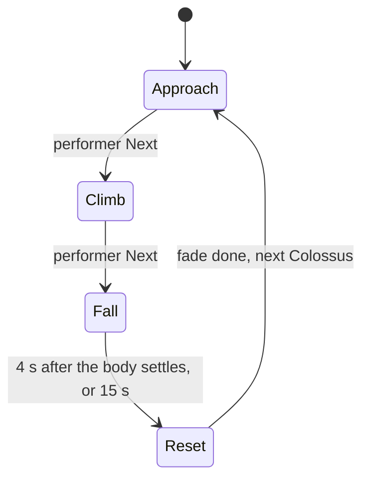

# Colossus Scene spec sheet

Terms follow [GLOSSARY.md](../../../GLOSSARY.md). The look lives in the art book; this sheet holds the numbers.

## Platform

| Item | Value |
|---|---|
| Engine | Godot 4.7.2 (mono build installed, GDScript only) |
| Renderer | Forward+, Metal driver (`rendering_device/driver.macos="metal"`) |
| Host | M1 Max, 32-core GPU, 64 GB |
| Output | Syphon server `COLOSSUS_OUT`, 1920×1080, 60 fps, picked up by Magic |
| Internal resolution | 0.75 scale, MetalFX temporal upscale (`Viewport.scaling_3d_mode = 4`) |
| Frame budget | 16.6 ms GPU, 8 ms CPU main thread |

## Budgets

| Item | Budget |
|---|---|
| Colossus | ≤ 100k tris, one rig, ≤ 24 physical bones for the Fall |
| Wanderer | ≤ 60k tris, Mixamo-compatible humanoid skeleton |
| Each ruin set | ≤ 300k tris after decimation, LODs on |
| Visible tris total | ≤ 3M |
| Draw calls | ≤ 1500 |
| Textures | 2k for hero assets, 4k only for the Colossus albedo/normal |

## World

| Item | Value |
|---|---|
| Units | metres, Y up |
| Terrain | Terrain3D, 8 × 8 km, 2 m vertex spacing, full collision; flat plain beyond the edge |
| Heightmap | Copernicus GLO-30 tile N63 W020, cropped to Mælifellssandur (centre 63.80 N 19.08 W, Fjallabak highlands): a black sand plain under the Mýrdalsjökull glacier foot. Landmannalaugar sits in the tile corner and has no plain to roam. Relief x1.5, plain at y = 0 |
| Wanderer height | 1.75 m |
| Colossus height | 20 to 40 m, set per Colossus; Grock Endboss at 28 m |
| Shrine | Temple Ruins pack, columns scaled to 10 to 14 m, on the glacier foot at (14, 1467), 80 m up, 850 m beyond the edge of the roaming area (centre (14, 15), radius 600 m) |
| Other ruins | Arch bridge across a canyon, toppled statue fragment in the plain, Faroe wall scans as scatter |
| Light | One sun 4° above horizon behind overcast, volumetric fog, SDFGI on, SSR off, SSIL on |

## Assets

| Role | Asset | License | Committed |
|---|---|---|---|
| Colossus 1 (start) | [Grock - Endboss](https://sketchfab.com/3d-models/grock-endboss-fc582e5f47da447d934d616ad271a3fe) by Baue Franco, 49k tris, 22 joints, 8 clips | CC-BY | yes |
| Colossus 2 | [Ancient Titan Vol2](https://sketchfab.com/3d-models/free-game-character-ancient-titan-vol2-0e71dd1a27a2455b9adae83082905958) by Kaan Tezcan, 56k tris; the rigged file is behind a link on that page | CC-BY (credit waived) | yes |
| Colossus 3 | [Golem Rock](https://sketchfab.com/3d-models/character-free-golem-rock-by-oscar-creativo-9383d3630e2945c5bdac5f7063308037) by Oscar Creativo, 84k tris | CC-BY label, "All rights reserved" in text | only after the author confirms |
| Wanderer | [Nomad Marksman Rig](https://sketchfab.com/3d-models/nomad-marksman-rig-aa3d08c56cc84d308e36920d3bcbe122) by DM-913, 50k tris | CC-BY | yes |
| Wanderer clips | Mixamo | Adobe terms, no redistribution | no, `assets/mixamo/` is git-ignored |
| Terrain textures, rock scans, sky | Poly Haven, ambientCG | CC0 | yes |
| Ruins | Temple Ruins pack, arch bridge, statue fragment (CC-BY), Faroe ruins (CC0) | as listed | yes |
| Heightmap | Copernicus GLO-30 | free, attribution required | yes |

Every CC-BY and Copernicus item gets a line in `CREDITS.md` when it is downloaded.

Mixamo clips needed: idle, walk, run, braced hang idle, braced hang shimmy left/right, climb up, climb down, hanging swing, fall idle, stand up.

## Arc



| Phase | Wanderer (autonomous) | Colossus | Camera director |
|---|---|---|---|
| Approach | walks from the Shrine toward the Colossus | roams, foot IK on terrain, head looks at the Wanderer | wide scale shots, slow drift |
| Climb | runs to the nearest Grab Point, then climbs toward the head | turns and walks to meet the Wanderer, stands while he climbs, Shakes on triggers | close grip, over-shoulder, low hero |
| Fall | holds on, lets go on impact, stands up | ragdoll takes over | wide collapse, then dust close-up |
| Reset | none | swap to the next Colossus | fade to black 2 s, open on the Shrine |

Only the performer advances Approach and Climb. Fall ends on its own.

## Grab Path

- A **Grab Point** is a node under a `BoneAttachment3D` on the Colossus. Fields: surface normal, grip kind (`ledge` or `fur`), links to neighbouring Grab Points.
- Links are authored by hand in each Colossus scene. A Grab Path must connect every Grab Point to the head.
- The Wanderer picks the link whose direction, projected onto the surface at the current Grab Point, best matches the input direction (autonomous: toward the head).
- The Colossus plants its feet with `TwoBoneIK3D`. The Wanderer's hands will use it once he has a rig. The body hangs from the grip as a pendulum during a Shake, swinging sideways along the surface. The grip never fails.

## Inputs

### OSC (from Magic through `lab.py`)

Magic sends to udp 9201, the scene port of both scenes (only one runs at a time). The optional debug relay `lab.py` (udp 9200) forwards to it; a second target for Godot on another port (`--godot-port`, settable on the lab page) is off by default. Godot reads the existing `/vj/*` addresses:

| Address | Wire | Drives |
|---|---|---|
| `/vj/beat` | 0..1, default 0 | Colossus footfall timing nudge, dust puffs, camera cut points |
| `/vj/bass` | 0..1, default 0 | footfall weight 0.5..1 (camera shake, dust size) |
| `/vj/level` | 0..1, default 0.5 | sun glow through the cloud gap, energy 1.0..2.6 |
| `/vj/shock` | trigger, 1.4 and above marks a drop | triggers a Shake while the Wanderer is on the Colossus |
| `/vj/fog` | 0..1, default 0.35 | volumetric fog density 0..0.0086 |
| `/vj/fog_height` | 0..1, default 0.41 | fog height 0..95 m |
| `/vj/haze` | 0..1, default 1 | distance haze density, none up to the tuned look |
| `/vj/cam` | 0..10, default 0 | the Nth director shot (0-based, clamped to the last), held while `/vj/cam_auto` is 0 |
| `/vj/cam_auto` | 0 or 1, default 1 | 1 hands the cuts to the director, 0 pins the shot `/vj/cam` names |
| `/vj/intensity` | 0..1, default 0.5 | overall exposure 0.2..1.8 |

A value stays until the next packet, as in Blender (Magic sends only on change); before the first packet an address has its rest value (the tuned look). Missing `/vj/beat` (no write for 2 s): an internal 90 BPM beat, as the Blender runtime does. The table of ranges, scaling and rest values is `io/vj_map.gd`. It follows the Godot column of `osc/contract.json` (contract decision of 2026-11-10: every continuous control 0..1, each scene scales it linearly onto one range, the wire default gives the tuned look); a test reads the JSON and fails when they drift.

The same values can be written from the control page on http 9211 (`/api/*`, see the README). Page values are held against OSC until released.

### Keyboard and mouse (Takeover)

| Input | Action |
|---|---|
| W A S D | steer the Wanderer; while climbing, choose climb direction |
| Shift | run |
| Space | grab the nearest Grab Point (Approach and Climb) / let go to the ground (Approach only) |
| Mouse move | camera Takeover |
| N | next Phase |
| R | Reset now |
| Q | Shake |
| C | swap to the next Colossus at the next Reset |
| 1 to 5 | force a director shot: 1 scale wide, 2 low hero, 3 over-shoulder climb, 4 close grip, 5 aerial orbit |
| F1 | debug overlay: Grab Points, links, IK targets, frame timings |

Takeover ends 4 s after the last input, for the Wanderer and the camera separately.

## Project layout

```
godot/colossus/
  project.godot
  addons/            godot_mcp, terrain_3d, godot-syphon (licences beside them)
  assets/dem/        the Copernicus crop
  assets/terrain/    CC0 ground textures
  assets/mixamo/     git-ignored
  colossi/           the Colossus base, the rigged stand-in, the roster, the Grab Path
  wanderer/
  world/             land, sky, fog, dust, film grain, shrine and ruins
  director/          camera shots and cut logic
  arc/               Phase state machine
  io/                OSC in, keyboard Takeover, debug overlay
  tests/             logic tests, smoke run, Metal capture
  docs/              this sheet, GUIDELINES.md
  CREDITS.md
```
